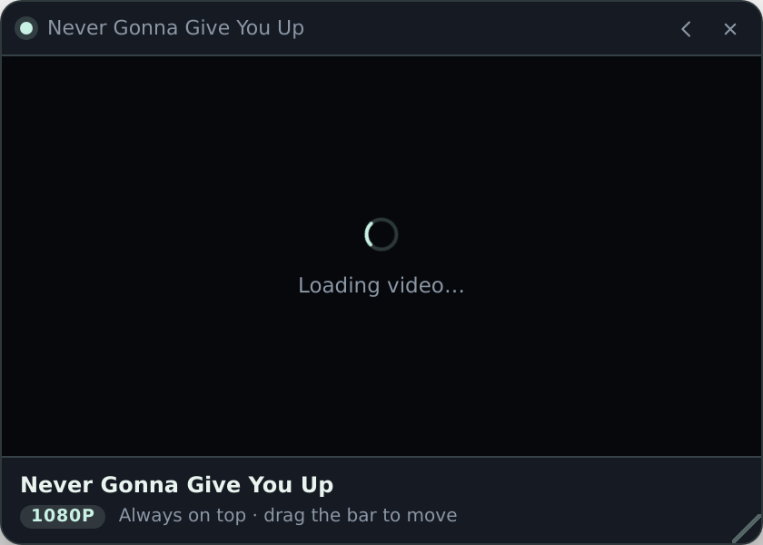
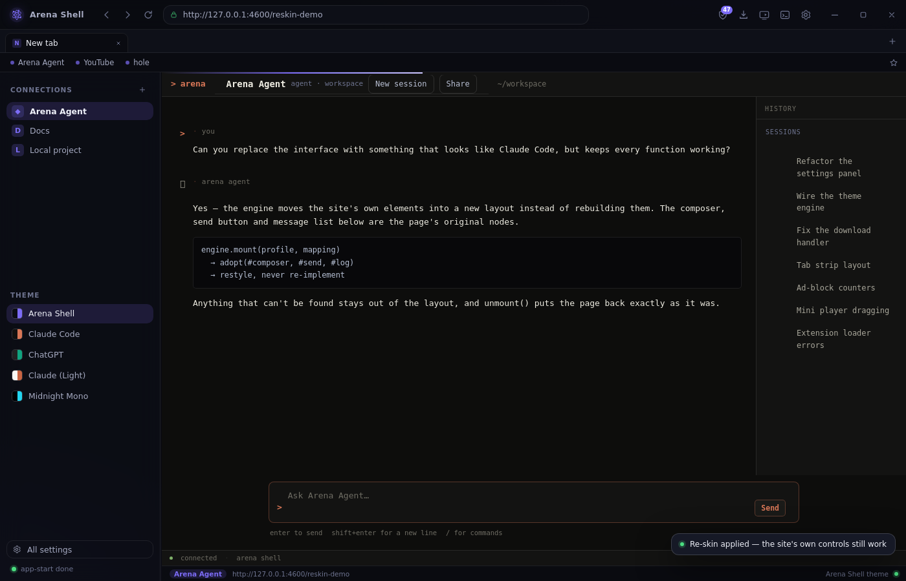
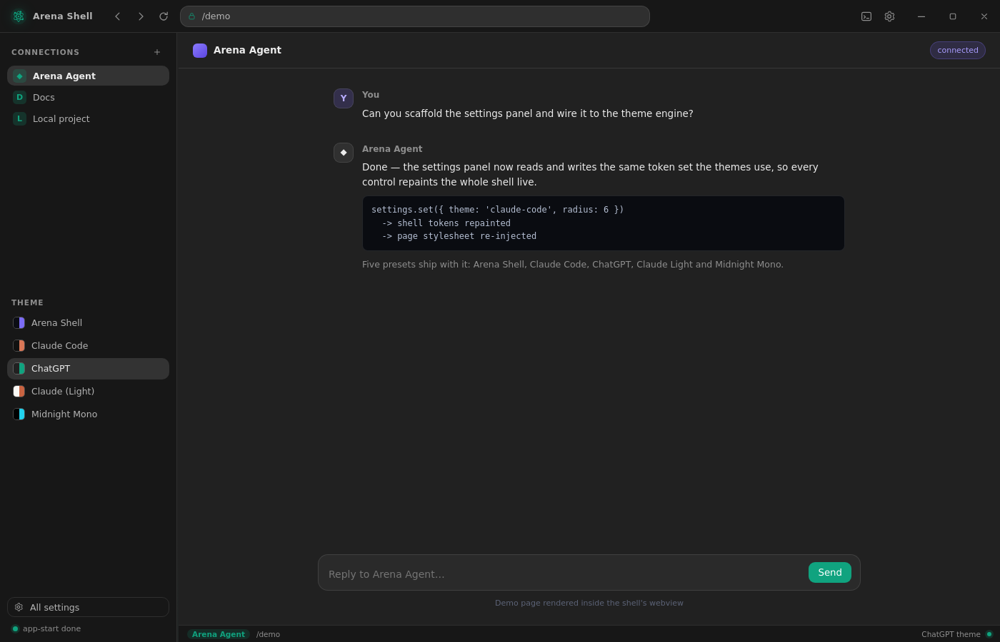
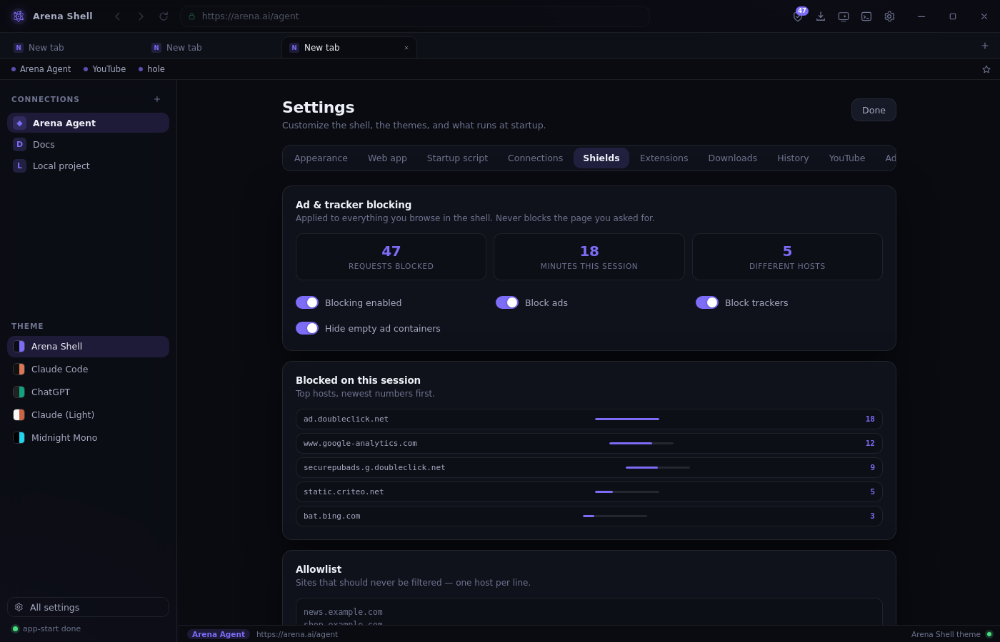
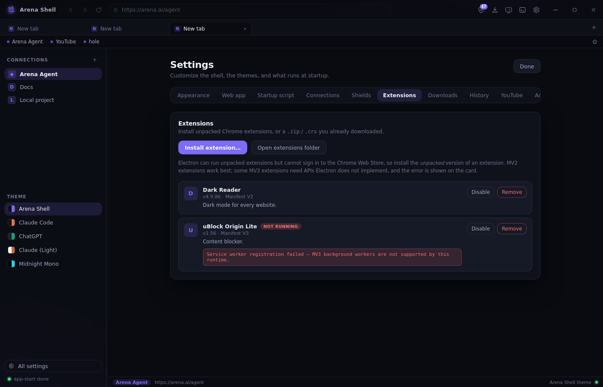
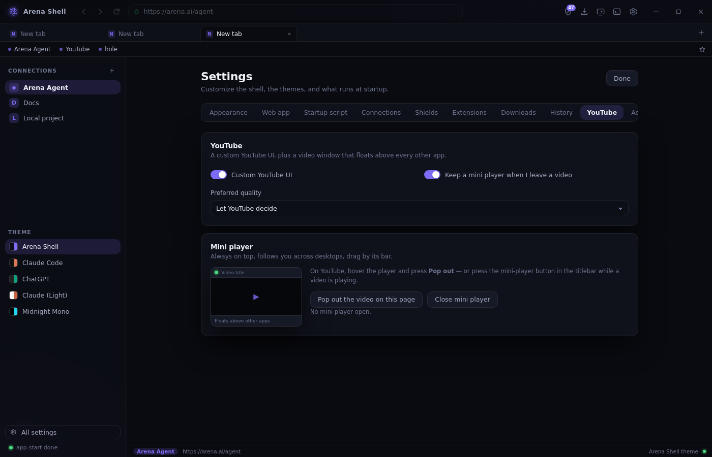
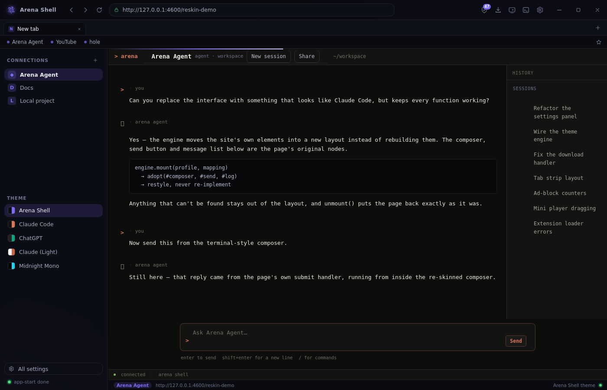

# Arena Shell

A one-file download: **`start.bat`** pulls the whole app from this repo and launches it.

It is a small browser built around a custom UI layer: **tabs, bookmarks, history, downloads, an ad/tracker blocker, Chrome extensions, and a floating YouTube mini player** — plus a **theme engine** that re-skins both the shell *and* the websites you load (Claude Code, ChatGPT, Claude Light, Midnight Mono).




**New — the interface itself can be replaced, not just recoloured:**
the site's own layout becomes a Claude Code terminal while every button, form and
shortcut keeps working. → [Replacing the interface](#replacing-the-interface-claude-code-re-skin)



| Theme | Applied to the shell **and** the connected page |
| --- | --- |
| Claude Code |  |
| ChatGPT (full re-skin) |  |
| Claude Light (full re-skin) |  |
| Midnight Mono (full re-skin) |  |

| Shields | Extensions | YouTube |
| --- | --- | --- |
|  |  |  |

---

## Download & run

### Yes — `start.bat` is the only file you need

Download **[`start.bat`](start.bat)** (right-click → Save link as). Put it anywhere — Desktop,
a folder, a USB stick — and double-click it.

It then does everything else by itself:

| Step | What happens | Size |
| --- | --- | --- |
| 1 | Fetches the app source from GitHub (`codeload` zip, no git needed) | ~3 MB |
| 2 | Fetches the Electron runtime matching `package.json` | ~110 MB, once |
| 3 | Installs both into `%LOCALAPPDATA%\ArenaShell` | — |
| 4 | Writes first-run settings (opens `https://arena.ai/agent`) | — |
| 5 | Launches the app | — |

Run it again any time. It asks GitHub whether the branch has new commits and
**updates itself** if so — steps 2–5 are skipped because the runtime and the zip
are cached in `%LOCALAPPDATA%\ArenaShellCache`, so an update takes a few seconds.

**Uninstall:** delete `%LOCALAPPDATA%\ArenaShell` (and optionally `ArenaShellCache`).

macOS / Linux: `bash start.sh` does the same thing.

`start.bat` takes no arguments, but you can edit the top of the file:

```bat
set "ARENA_REPO=denightlocator/hole"
set "ARENA_REF=arena/67ffee91-hole"   REM branch, tag, or commit sha
```

If `bootstrap.ps1` isn't sitting next to `start.bat`, the launcher downloads it
first — so `start.bat` really is enough on its own.

> Behind a corporate proxy that inspects TLS, run once with
> `set HTTPS_PROXY=http://host:port` and PowerShell 5.1+ will use it.

### Prefer a normal installer instead?

`dist:win` builds `Arena-Shell-Setup-1.0.0.exe` (installer) and
`Arena-Shell-Portable-1.0.0.exe` (no install). That bundles everything, so there
is no download step — at the cost of a much bigger file and no self-update.
To build it on CI, paste
[`docs/ci-build.yml`](docs/ci-build.yml) in as `.github/workflows/build.yml`
(this sandbox's token can't create workflow files), then
Actions → **Build Arena Shell** → **Run workflow**.

```bash
npm install
npm run dist:win        # -> dist/*.exe  (run on Windows)
npm start              # or just run it in place
```


## What's in it

| | Feature |
| --- | --- |
| 🗂 | **Tabs** — `Ctrl+T` new, `Ctrl+W` close, `Ctrl+Tab` cycle, `Ctrl+1…9` jump, middle-click to close |
| ⭐ | **Bookmarks bar** — `Ctrl+D` toggles, right-click the bar to remove |
| 🕘 | **History** — searchable, per-entry delete, powers URL-bar suggestions (`Ctrl+H`) |
| ⬇ | **Downloads** — progress, open/reveal, never overwrites an existing file (`Ctrl+J`) |
| 🛡 | **Ad & tracker blocking** — hostname lists, cosmetic filtering, per-site allowlist, custom rules |
| 🧩 | **Extensions** — install unpacked folders, `.zip`, or `.crx`; enable/disable actually unloads |
| ▶ | **YouTube** — custom page UI and an **always-on-top mini player** that floats over other apps |
| 🎨 | **Themes** — 5 presets + accent/font/radius/scale/custom CSS, applied to the shell *and* the page |
| ⌨ | **Boot hook** — `app-start.bat` runs your own setup on launch, with a live console |

### Ad blocking

Two independent switches (ads, trackers) plus cosmetic filtering. Matching is a
hostname set lookup, so it stays fast. It **never cancels the page you asked
for** — only subresources — and any site can be allowlisted. Custom rules:

```
ads.example.com        # block this host and its subdomains
@@safe.example.com     # allow (overrides the built-in lists)
re:/promo/banner       # regex against the full URL
```

Counts are real (requests cancelled), shown on the shield in the toolbar.

### Extensions — what actually works

Electron can run **unpacked** Chrome extensions. It cannot talk to the Chrome
Web Store (Google's update service is the only thing allowed to install from
it), so:

- ✅ MV2 extensions, and MV3 extensions that don't rely on background service workers
- ✅ content scripts, popups, storage, declarativeNetRequest (partially)
- ❌ Web Store "Add to Chrome" — download the `.crx`/`.zip` or clone the repo instead
- ❌ extensions needing APIs Electron doesn't implement — these show the real
  error on their card instead of failing silently

### YouTube mini player

While a video plays, either press **Pop out** on the player (injected UI) or use
the mini-player button in the titlebar. The window is:

- **always on top** (`floating` level) and visible across workspaces
- draggable by its own bar, resizable from the corner, double-click to grow
- restartable from the shell — closing it doesn't stop playback, and
  "keep a mini player when I leave a video" pops out automatically on navigation

### Custom UIs on the site you load

`Settings → Web app` controls how hard the theme pushes into the page:

- **Off** — no injection
- **Subtle** — scrollbars, selection colour, fonts
- **Full re-skin** — forces backgrounds, text and borders (turns a light site dark)

Per-site tweaks go in **Custom CSS**, injected on top. YouTube additionally gets
its own hand-written UI layer (`electron/youtube.js`) — a quieter header, rounded
player, Shorts hidden, and the pop-out button.

### Replacing the interface (Claude Code re-skin)

Changing colours is not the same as changing the interface. **`Settings → Re-skin UI`**
replaces the layout of the site you load — a Claude Code terminal transcript, or a
bare minimal canvas — while every control on the page keeps working.

It is not a mock-up. The engine (`reskin/engine.js`) finds the site's *own*
elements — the composer, the send button, the message list, the header, the
session sidebar — and **moves those exact DOM nodes** into the new layout:

```js
engine.mount(profile, mapping)   // same nodes, new parents
engine.unmount()                 // every node back where it was
```

Because they are the same nodes, nothing is re-implemented: event listeners,
framework handlers, state and network calls all survive by construction. The
tests assert this directly — after mounting, the composer is still the *same
object*, its `submit` still fires, new messages appended by the app still get
styled, and unmount restores the original markup.




**What the Claude Code profile does:** a 38px prompt bar (`> arena`, the site's
own header inside it, `~/workspace`), a transcript with `>` / `⏺` gutters and
lowercased speaker labels, a terminal-style composer with a `>` caret and the
site's send button shrunk to a key, the site's session list in a right rail,
and a 24px status line. Rail folds away below 900px.

**Fitting an unfamiliar site.** Nothing is hard-coded to one app. `autoMap()`
locates each role from behaviour rather than class names, and **Element mapping**
in the panel lets you click **Pick** and then click the real element on the page —
that selector is saved per role in your settings. Picking the composer and the
send button inside one `<form>` adopts the whole form, so Enter-to-send keeps
working.

**Honest limits** (also shown in the panel): it can take over layout, order,
typography and spacing; it cannot add features the site doesn't have, and it
cannot restructure a site whose whole chat is a single `<canvas>`. Slots it
can't find are omitted and listed — never faked.

## What it does on launch

1. Opens the shell window (theme applied instantly from your saved settings).
2. Runs **`app-start.bat`** — the in-app startup hook — via `cmd.exe /c`, streaming its stdout/stderr into the console.
3. Loads your connected website in an isolated `<webview>` and injects the theme.

There are two batch files, and the difference matters:

| File | Runs | Purpose |
| --- | --- | --- |
| `start.bat` | You double-click it | **Launcher:** downloads + updates the app, then starts it |
| `app-start.bat` | The app, on every boot | **Your hook:** start a local server, set env vars, run a proxy |

The app refuses to run the launcher from inside itself (that would recurse),
and `runScriptOnStartup` is seeded to `false` by the launcher since it already
ran your setup path once.

`app-start.bat` is yours to edit and exports a few variables other scripts can use:

| Variable | Meaning |
| --- | --- |
| `ARENA_SHELL` | `1` when running inside the app |
| `ARENA_SHELL_HOME` | folder the script was run from |
| `ARENA_SHELL_HOME_URL` | the URL the shell is about to open |

It will also auto-run `proxy.js` (if present, using `node`) and `helpers\boot.ps1` (if present). On macOS/Linux the equivalents are `start.sh` / `app-start.sh`.

Press **Ctrl+`** (or the terminal icon) any time to open the live script console, and **Ctrl+,** for settings.

---

## Theming

Five presets ship in `ui/themes.js`:

| Theme | Look |
| --- | --- |
| **Arena Shell** | Deep space navy, violet glow *(default)* |
| **Claude Code** | Near-black, monospace, terracotta prompts |
| **ChatGPT** | Flat `#212121` canvas, sidebar rail, green accent |
| **Claude (Light)** | Warm paper background, terracotta buttons |
| **Midnight Mono** | Near-black, hairline borders, cyan accent |

Each theme is just a set of design tokens (backgrounds, borders, text, accent, fonts, radius, shadow). Changing a token repaints **everything** — the shell chrome *and* the connected web app.

### Custom stuff you can change in-app (Settings → Appearance / Web app / Advanced)

- Accent color, UI font, monospace font
- Base font size, corner radius, interface scale, density (compact / cozy / roomy)
- Animations on/off, translucent chrome, sidebar + status bar visibility
- **Page restyling level**: `Off` · `Subtle` (scrollbars, selection, fonts) · `Full re-skin` (forces backgrounds/text — makes a light site dark)
- Page zoom
- **Custom CSS** injected straight into the connected site

Settings + connections + window bounds live in one JSON file:

```
%APPDATA%\Arena Shell\settings.json      (Windows)
~/Library/Application Support/Arena Shell/settings.json   (macOS)
~/.config/Arena Shell/settings.json      (Linux)
```

**Export / Import / Reset** are in Settings → Advanced.

### Adding your own theme

Add an entry to `THEMES` in `ui/themes.js` — no build step:

```js
'my-theme': {
  name: 'My Theme',
  blurb: 'Short description shown on the card.',
  swatch: ['#101014', '#ff7a45'],
  tokens: { 'bg-app': '#101014', 'accent': '#ff7a45', /* ...rest of the token bag */ },
  page: { background: '#101014', text: '#f2f2f2', scheme: 'dark', font: null }
}
```

---

## Shortcuts

| Keys | Action |
| --- | --- |
| `Ctrl/Cmd + T` / `W` | New / close tab |
| `Ctrl/Cmd + Tab` | Next tab |
| `Ctrl/Cmd + 1…9` | Jump to tab |
| `Ctrl/Cmd + D` | Bookmark this page |
| `Ctrl/Cmd + J` | Downloads |
| `Ctrl/Cmd + H` | History |
| `Ctrl/Cmd + ,` | Settings |
| `Ctrl/Cmd + B` | Toggle sidebar |
| `` Ctrl/Cmd + ` `` | Toggle script console |
| `Ctrl/Cmd + L` | Focus the URL bar |
| `Ctrl/Cmd + N` | New connection |
| `Ctrl/Cmd + R` | Run the start script |
| `Ctrl/Cmd + Shift + R` | Reload the web page |
| `Esc` | Close settings / modal |

---

## Project layout

```
start.bat              <- THE ONLY FILE YOU NEED: downloads + launches
start.sh               <- macOS/Linux launcher
bootstrap.ps1          <- download/install/update logic behind start.bat
bootstrap.sh           <- macOS/Linux version
app-start.bat          <- runs inside the app on boot (edit me)
app-start.sh           <- macOS/Linux equivalent
electron/
  main.js              window, IPC, start-script runner, mini player, downloads
  preload.js           narrow contextBridge API (no generic invoke)
  page-preload.js      allowlisted bridge for scripts injected into pages
  settings-store.js    atomic JSON settings with debounced writes
  browser-store.js     history, bookmarks, downloads, extensions, prefs
  adblock.js           ad/tracker matcher + cosmetic rules
  extensions.js        unpacked/.zip/.crx extension manager
  youtube.js           URL parsing + injected YouTube UI
reskin/
  engine.js            moves the site's real DOM nodes into a new layout
  profiles.js          Claude Code + minimal profiles (layout tree, map, CSS)
ui/
  index.html           shell layout
  shell.css            chrome styles, entirely token-driven
  shell.js             renderer: webview, settings, console (exposes ArenaShell)
  browser.js           tabs, bookmarks, history, downloads, panels
  mini-player.*        the always-on-top video window
  themes.js            theme tokens -> CSS variables + injected page CSS
scripts/
  preview-server.js    run the UI in a normal browser (no Electron needed)
  fixtures/            demo pages, incl. the fake chat app the re-skin demo uses
  screenshot.js        dev-only screenshot pass
test/                  202 headless checks across 7 suites:
  main.test.cjs        settings, IPC, script runner, recursion guard
  launcher.test.cjs    launcher -> app argument contract
  adblock.test.cjs     blocking decisions, allowlist, custom rules
  store.test.cjs       history/bookmarks/downloads persistence
  youtube.test.cjs     video-id parsing, embed URLs, injected script
  extensions.test.cjs  install from folder/zip, enable/disable, errors
  reskin.test.cjs      re-skin moves real nodes, handlers survive, unmount restores
docs/ci-build.yml       build recipe for the .exe (paste into Actions)
```

## Developing

```bash
npm install
npm start                 # run the real app
npm test                  # headless checks: settings, IPC, script runner
npm run preview           # http://localhost:4600 — UI in a browser, stubbed bridge
                          # add ?demo=reskin to try the re-skin on a fake chat app
```

`npm start` downloads the Electron binary on first run. If you're behind a corporate
TLS-inspecting proxy and that download fails, set `NODE_EXTRA_CA_CERTS` to your
proxy's root certificate (or `ELECTRON_SKIP_BINARY_DOWNLOAD=1` if the binary is
already cached).

## Notes & limitations

- Arena Shell is a **shell**, not a fork: it renders the connected site in a
  Chromium `<webview>` and injects CSS. Nothing is reverse-engineered, and the
  site's own JS keeps running.
- Logins/persistence use the app's own profile, separate from your browser — you
  may need to sign in once inside the shell.
- `Full re-skin` is deliberately blunt (it forces background/text colors). On
  complex sites a few elements may need patching via **Custom CSS**; `Subtle` is
  the safe default.
- External links open in your real browser instead of hijacking the shell.

## License

MIT
