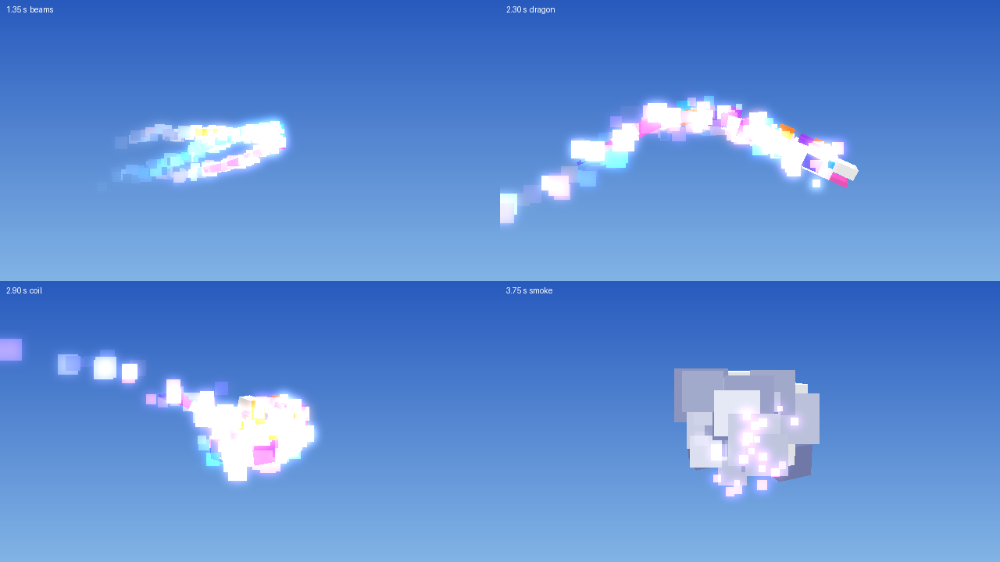

# Dragon Pulse for Bloxd.io

The move from `beam_blast_frames/`, rebuilt for [bloxd.io](https://bloxd.io) with
mesh entities, particles and code.



*Drawn by `dragon_pulse/tools/render.py` from a test run outside the game. It is a
rough picture, not a screenshot.*

## Install

1. Open your world, press **F8** and paste all of
   [`dragon_pulse/world_code.js`](dragon_pulse/world_code.js) into World Code.
2. Cast it one of three ways:
   - type `!dp` in chat;
   - place a Code Block, paste [`dragon_pulse/code_block.js`](dragon_pulse/code_block.js)
     into it and click it;
   - set `item` in `DP_CFG` to an item name, hold that item and right click.

The move fires the way you look. If you look at a player or mob within 40 blocks,
the dragon hunts it; otherwise it flies until it reaches a wall or its range.

If your World Code already has `tick`, `onPlayerChat` or `onPlayerAltAction`, do
not paste the three callbacks at the bottom. Put the one line inside each into
your own callback instead.

## Size

| File | Goes into | Characters | Limit |
|---|---|---|---|
| `world_code.js` | World Code | 22,639 | 512,000 |
| `code_block.js` | Code Block | 164 | 32,000 |
| `studio/particles_only.code_block.js` | Code Block | 13,362 | 32,000 |

## What the frames show, and how it is built

The 20 frames cover 1.50 s to 6.25 s of the clip.

| Frames | In the clip | In Bloxd | Seconds |
|---|---|---|---|
| 01–03 | Three orbs charge: violet, orange and cyan, each with a white core | 6 meshes (core + turning shell per orb), glow and dust particles | 0.0–0.8 |
| 04–05 | Three beams with white cores shoot off side by side | The orbs fly off with 4 beam pieces each, particle streaks behind | 0.8–1.5 |
| 06 | The beams merge into one white column with a magenta and blue edge | White flash and ring where the beams meet | 1.5 |
| 07–11 | The energy becomes a serpent dragon: white body, mottled pink, violet, blue and orange, with a head and jaws. It arches up and chases the target | 27 meshes: a 10-part head and a 17-part body that bends along the path the head flew. Skin shimmer and white outline particles | 1.5–3.0 |
| 12–16 | It wraps round the target; two yellow-orange stars flash | The dragon circles the target; two 4-part star meshes and gold sparks | 3.0–3.6 |
| 17 | White explosion with thin arcs | White core mesh, flash, shock ring. Damage and knockback happen here | 3.6–3.8 |
| 18–20 | Rolling white smoke with blue-grey shading, violet sparks left over | 8 smoke meshes that roll out and shrink, smoke and spark particles | 3.8–5.2 |

Seconds are for a cast at nothing. With a target the dragon arrives sooner or later.

## The meshes

Every mesh is one row in `DP_MESH` in `world_code.js`:

```
[name, width, height, depth, colour, forward, right, up, flag]
```

| Group | Rows | What it is |
|---|---|---|
| `orb` | 2 | Core and shell, used three times with the colours in `DP_ORBS` |
| `beam` | 1 | One piece of beam, 4 behind each orb |
| `head` | 10 | Skull, snout, jaw, two horns, crest, two eyes, two cheek fins |
| `body` | 17 | Neck, back and tail from thick to thin, three back spines, two tail fins |
| `flare` | 4 | The yellow star: a core and three rays |
| `blast` | 1 | The white core of the explosion |
| `smoke` | 8 | White and blue-grey puffs |

To change a part, change its row. To add one, add a row: the engine picks it up.
At most 31 meshes exist at once, and all are deleted when the move ends.

## The particles

The 12 particle looks are in `DP_FX` in `world_code.js`, in seconds and blocks.

To look at them and change them in the
[Bloxd Particle Studio](https://epicoo00000.github.io/Bloxd-Particle-studio/),
press **Open** there and pick
[`dragon_pulse/studio/dragon_pulse.scene.json`](dragon_pulse/studio/dragon_pulse.scene.json).
It holds the particles of all six phases in six groups, 598 particles, on the same
timeline. Press Play to watch it.

The studio shows particles only, not meshes, and its scene fires along one fixed
direction from the code block. `studio/particles_only.code_block.js` is that scene
exported by the studio: a version of the move for one code block, without World
Code, meshes, aiming or damage.

## Settings

All in `DP_CFG` at the top of `world_code.js`: chat word, item, cooldown, range,
damage, blast radius, knockback, whether the caster can be hurt, sounds, view
distance, and the caps on casts and meshes.

## Not tested in the game

I could not run Bloxd from here. The code was run against a stand-in for the game's
`api` written from the [official API documentation](https://github.com/Bloxdy/code-api).
That checks sizes, that every call is well formed and that every mesh is deleted.
It cannot show how the game draws it. Things to look at first in your world:

- **Mesh turning.** Meshes are turned to face the way they fly with
  `api.setEntityRotation`. The documentation does not say which way round the
  angles go. If the beams or the dragon's parts point the wrong way, set
  `rotate: false`: the parts then stay level, in the right places.
- **Mesh limit.** The game limits mesh entities but does not publish the number.
  If parts of the dragon are missing, lower `maxCasts`, or remove rows from `body`.
- **Code block.** `code_block.js` calls a function defined in World Code. If your
  world reports that `dragonPulse` is not defined, use the chat word or the item.
- **Walls.** The documentation does not describe what `api.raycastForBlock`
  returns. If the dragon flies through walls, that reading is wrong.
- **Particle speed and blend.** Lifetimes and speeds assume the particle clock the
  studio measured (0.6 per second).

## Files

| Path | What it is |
|---|---|
| `beam_blast_frames/` | The 20 reference frames |
| `dragon_pulse/world_code.js` | The move. Paste into World Code |
| `dragon_pulse/code_block.js` | One line for a code block that casts it |
| `dragon_pulse/studio/dragon_pulse.scene.json` | The particles as a Particle Studio scene |
| `dragon_pulse/studio/particles_only.code_block.js` | That scene exported by the studio |
| `dragon_pulse/studio/build_scene.mjs` | Writes the scene and checks it with the studio's code |
| `dragon_pulse/tools/sim.mjs` | The test run: `node dragon_pulse/tools/sim.mjs --target` |
| `dragon_pulse/tools/render.py` | Draws the test run (needs Pillow) |
| `dragon_pulse/preview/` | The drawings |
