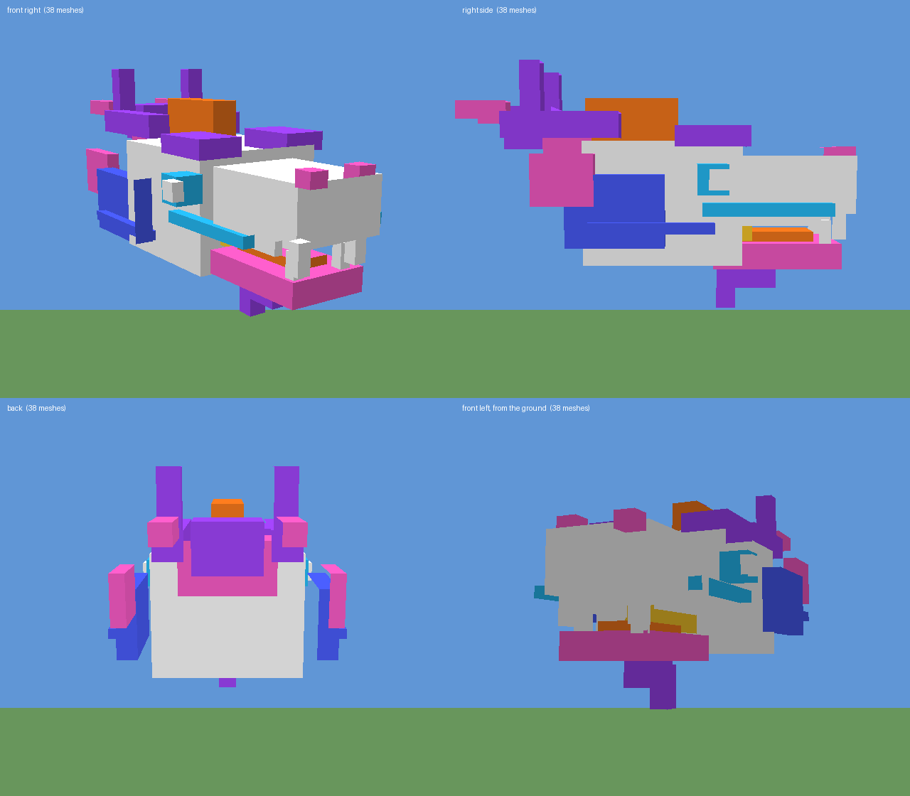

# Dragon Pulse for Bloxd.io

The move from `beam_blast_frames/`, rebuilt for [bloxd.io](https://bloxd.io) with
mesh entities, particles and code.


*Drawn by `dragon_pulse/tools/render.py` from a test run outside the game. It is a
rough picture, not a screenshot.*

## Install

1. Open your world, press **F8** and paste all of
   [`dragon_pulse/world_code.js`](dragon_pulse/world_code.js) into World Code.
2. Cast it one of three ways:
   - type `!dp` in chat;
   - place a Code Block, paste [`dragon_pulse/code_block.js`](dragon_pulse/code_block.js)
     into it and click it;
   - set `item` in `DP_CFG` to an item name, hold that item and right click.

The beams fly up into the sky, become the dragon there, and the dragon dives onto
the target it chose:

1. the mob or player you are looking at;
2. otherwise the mob nearest to you within 40 blocks;
3. otherwise the nearest other player (`hitPlayers: false` turns this off);
4. with nothing in range, the spot you are looking at.

If your World Code already has `tick`, `onPlayerChat` or `onPlayerAltAction`, do
not paste the three callbacks at the bottom. Put the one line inside each into
your own callback instead.

## Goodra

The Pokemon that fires the move in frame 01 is Goodra.
[`dragon_pulse/goodra.js`](dragon_pulse/goodra.js) builds it from 125 Box meshes.


*Drawn by `dragon_pulse/tools/render_model.py` outside the game: a rough picture,
not a screenshot.*

Paste `goodra.js` into World Code **below** `world_code.js`. It also works alone.

| Chat | What happens |
|---|---|
| `!goodra` | Goodra stands where you are, facing the way you look |
| `!goodra pulse` | It fires Dragon Pulse from its mouth |
| `!goodra off` | It is removed |

Every mesh is one named row in `GOODRA_MESH`, in 11 groups: `head`, `face`,
`antennae`, `neck`, `torso`, `belly`, `arms`, `legs`, `tail`, `spots`, `slime`.
Parts that exist on both sides are written once and mirrored.

`GOODRA_CFG` sets the size (`scale`, 0.6 is about 4 blocks tall) and the number of
parts (`detail`): 1 is the body and eyes with 51 meshes, 2 adds face, spots and
belly for 92, 3 is everything with 125.

The eyes stand out from the head and glow, so they show from the ground and at
night.

Not tested in the game either. Two things to look at:

- **Mesh limit.** The game does not publish how many mesh entities a world may
  hold. If it refuses one, Goodra stops there and tells you in chat how many parts
  are missing. Lower `detail` then.
- **Mesh turning.** Goodra is turned to face you and some parts are tilted, with
  the same call the dragon uses. If parts sit at odd angles, set `rotate: false`:
  it then faces north, east, south or west and nothing is tilted.

`!goodra off` removes the Goodra this World Code made. If you save World Code
again while one stands, that one stays: remove it first.

## Size

| File | Goes into | Characters | Limit |
|---|---|---|---|
| `world_code.js` | World Code | 20,613 | 512,000 |
| `goodra.js` | World Code, below `world_code.js` | 10,215 | 512,000 together: 30,829 |
| `code_block.js` | Code Block | 18 | 32,000 |
| `studio/particles_only.code_block.js` | Code Block | 13,414 | 32,000 |

The files to paste hold no `//` comments, to save space. What the settings and
the table columns mean is written on this page instead.

## What the frames show, and how it is built

The 20 frames cover 1.50 s to 6.25 s of the clip.

| Frames | In the clip | In Bloxd | Seconds |
|---|---|---|---|
| 01–03 | Three orbs charge: violet, orange and cyan, each with a white core | 6 meshes (core + turning shell per orb), glow and dust particles | 0.0–0.8 |
| 04–05 | Three beams with white cores shoot up into the sky side by side | The orbs fly 16 blocks up with 4 beam pieces each, particle streaks behind | 0.8–1.5 |
| 06 | The beams merge into one white column with a magenta and blue edge | White flash and ring where the beams meet, high up | 1.5 |
| 07–11 | The energy becomes a serpent dragon: white body, mottled pink, violet, blue and orange, with a head and jaws. It arches over and dives after the target | 94 meshes: a 38-part head and a 56-part body that bends along the path the head flew. Skin shimmer and white outline particles | 1.5–3.3 |
| 12–16 | It wraps round the target; two yellow-orange stars flash | The dragon circles the target; two 4-part star meshes and gold sparks | 3.3–3.9 |
| 17 | White explosion with thin arcs | White core mesh, flash, shock ring. Damage and knockback happen here | 3.9–4.1 |
| 18–20 | Rolling white smoke with blue-grey shading, violet sparks left over | 8 smoke meshes that roll out and shrink, smoke and spark particles | 4.1–5.5 |

Seconds are for a cast with nothing in range. How long the dive takes depends on how far the target is.

## The meshes

Every mesh is one row in `DP_MESH` in `world_code.js`:

```
[name, width, height, depth, colour, forward, right, up, flag]
```

| Group | Rows | What it is |
|---|---|---|
| `orb` | 2 | Core and shell, used three times with the colours in `DP_ORBS` |
| `beam` | 1 | One piece of beam, 4 behind each orb |
| `head` | 38 | Skull, snout and open jaw; horns with antlers and tips; brows, eyes and pupils; fangs, teeth, tongue and a glowing throat; whiskers, nostrils, mane, cheek frills, chin and beard |
| `body` | 56 | 12 segments from thick neck to thin tail, a spine on each, belly plates, coloured patches on both sides, two pairs of side fins, tail fins |
| `flare` | 4 | The yellow star: a core and three rays |
| `blast` | 1 | The white core of the explosion |
| `smoke` | 8 | White and blue-grey puffs |

To change a part, change its row. To add one, add a row: the engine picks it up.
The numbers are meshes made at full detail; parts on both sides are written once
and mirrored. `detail` in `DP_CFG` sets how much of the dragon is made: 1 gives 27
meshes, 2 gives 63, 3 gives 94.




*Drawn outside the game with plain light so the parts can be told apart. In the
game they glow.*

At most 98 meshes exist at once in one cast, and all are deleted when the move ends.

## The particles

The 12 particle looks are in `DP_FX` in `world_code.js`, in seconds and blocks.

To look at them and change them in the
[Bloxd Particle Studio](https://epicoo00000.github.io/Bloxd-Particle-studio/),
press **Open** there and pick
[`dragon_pulse/studio/dragon_pulse.scene.json`](dragon_pulse/studio/dragon_pulse.scene.json).
It holds the particles of all six phases in six groups, 598 particles, on the same
timeline. Press Play to watch it.

The studio shows particles only, not meshes, and its scene always goes up from the
code block and comes down 28 blocks away. `studio/particles_only.code_block.js` is that scene
exported by the studio: a version of the move for one code block, without World
Code, meshes, aiming or damage.

## Settings

`DP_CFG` at the top of `world_code.js`:

| Setting | Meaning |
|---|---|
| `chat` | Chat message that casts the move. `""` turns it off |
| `item` | Held item that casts it on right click. `""` turns it off |
| `range` | Blocks around the caster in which the dragon finds a target |
| `rise` | Blocks the beams fly up before they become the dragon |
| `lean` | How far the beams lean forward on the way up. 0 is straight up |
| `hitPlayers` | `false`: the dragon only goes for mobs |
| `damage` | Health taken at the centre of the blast |
| `radius` | Blast radius in blocks |
| `knockback` | Push away from the blast |
| `hurtCaster` | `true`: the blast also hurts whoever cast it |
| `rotate` | Turn meshes to face the way they fly |
| `sounds` | Play sounds |
| `hideDist` | Players further away than this many blocks do not see it |
| `maxCasts` | Casts that may run at once in the world |
| `detail` | 1, 2 or 3: how many parts the dragon has |
| `maxMeshes` | Mesh entities all running casts may hold together |

`GOODRA_CFG` at the top of `goodra.js`:

| Setting | Meaning |
|---|---|
| `chat` | The chat word, `!goodra` |
| `scale` | Size. 1 is 6.8 blocks tall, 0.6 about 4 |
| `detail` | 1, 2 or 3: how many parts are made |
| `rotate` | Turn and tilt the meshes. `false`: it faces north, east, south or west |
| `perTick` | Meshes made per tick while it is being built |
| `hideDist` | Players further away than this many blocks do not see it |

## The table columns

**`DP_MESH`** (the move): `[name, width, height, depth, colour, forward, right, up, flag]`

- width is left to right, height bottom to top, depth along the flight.
- forward, right, up: where the part sits, in blocks from the middle of its group.
  In `body`, forward is how far behind the head the part follows (negative). In
  `smoke`, it is where the puff ends up.
- colour: a name from `DP_COL`. `"tint"` is the colour of the orb it belongs to.
- flag: `spin` turns by itself, `lit` is shaded instead of glowing. `m` makes the
  part twice, mirrored left and right (write it for the right side). `2` or `3`
  makes it only at that detail level or higher.

**`GOODRA_MESH`**: `[name, width, height, depth, colour, forward, right, up, tilt, turn, lean, flags]`

- forward, right, up: where the middle of the part is, in blocks from the point on
  the ground between the feet, before `scale`.
- tilt, turn, lean: degrees. Tilt leans the top forward, turn turns it to its
  right, lean leans the top to its right. Leave them out for 0.
- colour: a name from `GOODRA_COL`.
- flags: `m` makes the part twice, mirrored left and right (write it for the right
  side). `2` or `3` makes it only at that detail level or higher. `g` makes it glow.

**`DP_FX`** (particle looks):

| Field | Meaning |
|---|---|
| `tex` | Texture name |
| `life` | Shortest and longest life in seconds |
| `size` | Smallest and largest size in blocks |
| `speed` | Slowest and fastest speed in blocks per second |
| `grav` | Pull in blocks per second squared. Up is + |
| `col` | The two colours a particle is mixed from. `"tint"` and `"tint2"` are given when it is played |
| `fade` | How solid it is at birth and at death, 0 to 1 |
| `blend` | 1 normal, 2 glow |
| `drag` | Share of its speed left at the end. 1 keeps flying |
| `flat` | 1: flies level, for rings |

`DP_ORBS` holds the colour of each orb and its place round the launch line in
degrees. `DP_SKIN` holds the colour pairs the dragon shimmers in. `GOODRA_MOUTH`
is where Dragon Pulse leaves Goodra: forward, right, up.

## Not tested in the game

I could not run Bloxd from here. The code was run against a stand-in for the game's
`api` written from the [official API documentation](https://github.com/Bloxdy/code-api).
That checks sizes, that every call is well formed and that every mesh is deleted.
It cannot show how the game draws it. Things to look at first in your world:

- **Mesh turning.** Meshes are turned to face the way they fly with
  `api.setEntityRotation`. The documentation does not say which way round the
  angles go. If the beams or the dragon's parts point the wrong way, set
  `rotate: false`: the parts then stay level, in the right places.
- **Mesh limit.** The game limits mesh entities but does not publish the number.
  If parts of the dragon are missing, lower `detail`.
- **Many casts at once.** There is no cooldown. Up to `maxCasts` (3) casts run
  together and share `maxMeshes` (130), so a second dragon at full detail is cut
  short while the first still flies. Lower `detail` or raise `maxMeshes` for more.
- **Speed.** At full detail the dragon makes about 160 api calls per tick. If the
  game stutters or stops the script, lower `detail`.
- **Code block.** `code_block.js` calls a function defined in World Code. If your
  world reports that `dragonPulse` is not defined, use the chat word or the item.
- **Roofs and walls.** Under a roof the beams stop below it. The dragon itself
  flies through blocks on its way to the target.
- **Particle speed and blend.** Lifetimes and speeds assume the particle clock the
  studio measured (0.6 per second).

## Files

| Path | What it is |
|---|---|
| `beam_blast_frames/` | The 20 reference frames |
| `dragon_pulse/world_code.js` | The move. Paste into World Code |
| `dragon_pulse/goodra.js` | Goodra. Paste into World Code below the move |
| `dragon_pulse/code_block.js` | One line for a code block that casts it |
| `dragon_pulse/studio/dragon_pulse.scene.json` | The particles as a Particle Studio scene |
| `dragon_pulse/studio/particles_only.code_block.js` | That scene exported by the studio |
| `dragon_pulse/studio/build_scene.mjs` | Writes the scene and checks it with the studio's code |
| `dragon_pulse/tools/sim.mjs` | The test run: `node dragon_pulse/tools/sim.mjs --target` |
| `dragon_pulse/tools/goodra_check.mjs` | The test of Goodra: `node dragon_pulse/tools/goodra_check.mjs` |
| `dragon_pulse/tools/dragon_model.mjs` | Lays the dragon out straight for a drawing |
| `dragon_pulse/tools/render_model.py` | Draws Goodra and the dragon (needs Pillow) |
| `dragon_pulse/tools/render.py` | Draws the test run (needs Pillow) |
| `dragon_pulse/preview/` | The drawings |
