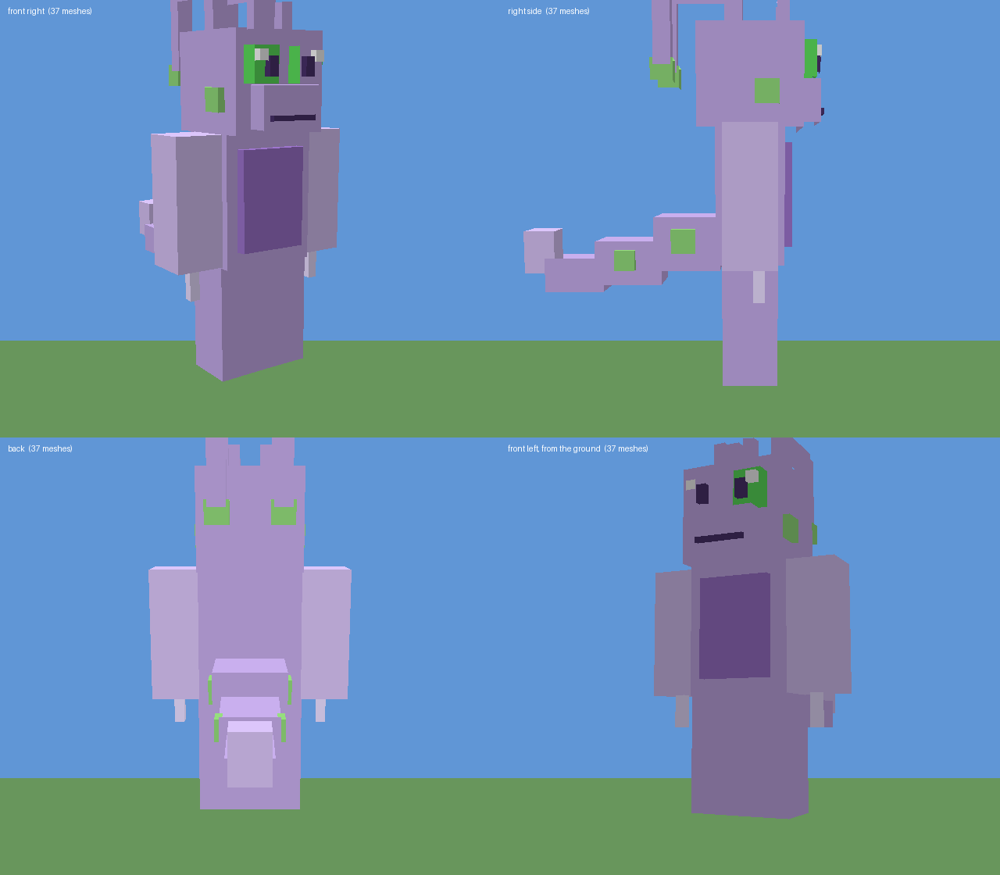

# Dragon Pulse for Bloxd.io

The move from `beam_blast_frames/`, rebuilt for [bloxd.io](https://bloxd.io) with
mesh entities, particles and code.


*Drawn by `dragon_pulse/tools/render.py` from a test run outside the game. It is a
rough picture, not a screenshot.*

## Install

1. Open your world, press **F8** and paste all of
   [`dragon_pulse/world_code.js`](dragon_pulse/world_code.js) into World Code.
2. Cast it one of three ways:
   - type `!dp` in chat;
   - place a Code Block, paste [`dragon_pulse/code_block.js`](dragon_pulse/code_block.js)
     into it and click it;
   - set `item` in `DP_CFG` to an item name, hold that item and right click.

A summoning circle draws itself on the floor 4 blocks in front of you. After 2.5
seconds the dragon comes up out of it, dashes 16 blocks into the air, circles
there while it finds a target, then dives onto it and kills it. The target is:

1. the mob or player you were looking at when you cast;
2. otherwise the mob nearest to the circle within 40 blocks;
3. otherwise the nearest other player (`hitPlayers: false` turns this off);
4. with nothing in range, the spot you were looking at.

**Two dragons that touch merge.** One dragon 2.2 times the size is left. It climbs
22 blocks and explodes into a nuke that kills every mob and player within 22
blocks, except the players who cast the two dragons. Dragons touch when their
paths cross, for example when two players cast at each other at about the same
time, or one player casts twice in a row. `merge: false` turns this off.

If your World Code already has `tick`, `onPlayerChat` or `onPlayerAltAction`, do
not paste the three callbacks at the bottom. Put the one line inside each into
your own callback instead.

## Goodra

The Pokemon that fires the move in frame 01 is Goodra.
[`dragon_pulse/goodra.js`](dragon_pulse/goodra.js) builds it from 125 Box meshes.


*Drawn by `dragon_pulse/tools/render_model.py` outside the game: a rough picture,
not a screenshot.*

Paste `goodra.js` into World Code **below** `world_code.js`. It also works alone.

| Chat | What happens |
|---|---|
| `!goodra` | Goodra stands where you are, facing the way you look |
| `!goodra pulse` | It casts Dragon Pulse: the summoning circle appears on the floor in front of it |
| `!goodra off` | It is removed |

Every mesh is one named row in `GOODRA_MESH`, in 11 groups: `head`, `face`,
`antennae`, `neck`, `torso`, `belly`, `arms`, `legs`, `tail`, `spots`, `slime`.
Parts that exist on both sides are written once and mirrored.

`GOODRA_CFG` sets the size (`scale`, 0.6 is about 4 blocks tall) and the number of
parts (`detail`): 1 is the body and eyes with 51 meshes, 2 adds face, spots and
belly for 92, 3 is everything with 125.

The eyes stand out from the head and glow, so they show from the ground and at
night.

Not tested in the game either. Two things to look at:

- **Mesh limit.** The game does not publish how many mesh entities a world may
  hold. If it refuses one, Goodra stops there and tells you in chat how many parts
  are missing. Lower `detail` then.
- **Mesh turning.** Goodra is turned to face you and some parts are tilted, with
  the same call the dragon uses. If parts sit at odd angles, set `rotate: false`:
  it then faces north, east, south or west and nothing is tilted.

`!goodra off` removes the Goodra this World Code made. If you save World Code
again while one stands, that one stays: remove it first.

## Skins made of node meshes

[`dragon_pulse/skin.js`](dragon_pulse/skin.js) dresses a player in meshes that are
attached to the body parts ("nodes") of the player model, so they move with the
player by themselves. Paste it into World Code, alone or below the other files.

| Chat | What happens |
|---|---|
| `!skin goodra` | You wear Goodra: lilac body, green eyes and spots, antennae, belly, tail |
| `!skin dragon` | You wear the Dragon Pulse dragon: glowing white, horns, crest, whiskers, spines, fins, tail |
| `!skin off` | The skin is taken off |



*Drawn outside the game on a guessed player shape. The other skin is in
`dragon_pulse/preview/skin_dragon.png`.*

Each skin is a list in `SKINS`, 37 parts each. One row is one Box:

```
[node, width, height, depth, colour, right, up, front, flags]
```

- node: `HeadMesh`, `TorsoNode`, `ArmRightMesh`, `ArmLeftMesh`, `LegRightMesh` or
  `LegLeftMesh`.
- right, up, front: where the middle of the box is, in blocks from that node.
- colour: a name from `SKIN_COL`.
- flags: `x` is an extra (see below), `m` makes it twice, mirrored left and right,
  `g` makes it glow.

To make your own skin, add a list to `SKINS` under a new name: `!skin` and that
name then wears it.

`SKIN_CFG`: `chat` is the chat word, `extras` turns the extra parts on or off,
`front` is 1 or -1 (see below), `scale` resizes every part, `hideDist` is how far
away it is seen.

Not tested in the game. The documentation leaves three things open:

- **How many meshes a node holds.** If the game keeps only one per node, you see
  six plain boxes: the first six rows of a skin, one per body part. The code
  attaches those last so that they are the ones that stay. The other rows are the
  extras (face, antennae, tail and so on) and only show if the game keeps several.
- **Where a node is.** The offsets assume the head node is at the neck, the arm
  nodes at the shoulders, the leg nodes at the hips and the torso node in the
  middle of the torso. If a part sits too high or too low, change the `up` number
  of its rows.
- **Which way is front.** If the face and belly are on your back, set `front: -1`.

The meshes sit over your own skin; they do not hide it.

## Size

| File | Goes into | Characters | Limit |
|---|---|---|---|
| `world_code.js` | World Code | 24,539 | 512,000 |
| `goodra.js` | World Code, below `world_code.js` | 10,215 | 512,000 together: 34,754 |
| `skin.js` | World Code | 6,032 | 512,000, all three together: 40,786 |
| `code_block.js` | Code Block | 18 | 32,000 |
| `studio/particles_only.code_block.js` | Code Block | 13,414 | 32,000 |

The files to paste hold no `//` comments, to save space. What the settings and
the table columns mean is written on this page instead.

## How the move runs

| Step | What happens | Built from | Seconds |
|---|---|---|---|
| circle | The summoning circle draws itself ring by ring; the star in it turns | 38 flat meshes in 6 rings, rising sparks | 0.0–2.5 |
| emerge | A pillar of light, then the dragon comes up through the floor and spirals 16 blocks up | 100 meshes: a 42-part head and a 58-part body that follows the head's path | 2.5–3.15 |
| seek | It circles at the top, then picks its target; a ring flashes on the target | the same dragon | 3.15–3.75 |
| dive | It weaves down onto the target | the same dragon, shimmer particles | 3.75–4.7 |
| coil | It wraps round the target; two stars flash | two 4-part star meshes, sparks | 4.7–5.3 |
| blast | White explosion. The target is killed, others within 6 blocks are hurt and pushed | core mesh, flash, shock ring | 5.3–5.5 |
| smoke | Smoke rolls out and shrinks | 8 smoke meshes, smoke and sparks | 5.5–6.9 |

After two dragons touch, the one that is left runs these steps instead:

| Step | What happens | Built from | Lasts |
|---|---|---|---|
| mega | The merged dragon, 2.2 times the size, spirals 22 blocks up | the same 100 meshes, bigger | 1.2 s |
| nuke | A fireball with three rays grows until it reaches the ground; shock waves in the sky and on the ground. Everything within 22 blocks dies | 4 meshes that grow, flashes and waves | 0.8 s |
| cloud | A mushroom cloud: a cap three times the size of the normal smoke on a stem down to the ground | 8 cap meshes, 5 stem meshes, smoke | 2.5 s |

How long the dive takes depends on how far the target is. The clip in
`beam_blast_frames/` started this move (orbs, beams, a white dragon); the circle,
the purple dragon and the nuke are changes asked for later.

## The meshes

Every mesh is one row in `DP_MESH` in `world_code.js`:

```
[name, width, height, depth, colour, forward, right, up, flag]
```

| Group | Rows | What it is |
|---|---|---|
| `pillar` | 1 | The pillar of light when the dragon comes out |
| `head` | 42 | Purple skull, snout and open jaw; two pairs of dark swept-back horns with magenta tips; brows, cyan eyes and pupils; a gem on the forehead; fangs, teeth, tongue and a glowing throat; whiskers, nostrils, mane, cheek fins and frills, chin spikes, beard |
| `body` | 58 | 12 segments from thick neck to thin tail, purple and dark purple in turn; a tall magenta spine on each, lilac belly plates, cyan stripes on both sides, a pair of wings with lilac tips, a pair of fins, tail fins |
| `flare` | 4 | The star: a core and three rays |
| `blast` | 1 | The white core of the explosion |
| `smoke` | 8 | White and violet-grey puffs; also the cap of the mushroom cloud |
| `nuke` | 4 | The fireball and its three rays |
| `stem` | 1 | One piece of the mushroom cloud's stem, used 5 times |

To change a part, change its row. To add one, add a row: the engine picks it up.

Every row in `DP_MESH` is named `M`. What each row is, in order:

- `flare`: core, then the three rays.
- `smoke`: puffs 1 to 8.
- `nuke`: fireball, then the three rays.
- `body`: for each of the 12 segments from neck to tail tip, the segment itself,
  then its spine, then (where it has them) its belly plate, side stripes, and
  wings or fins. The wing tips follow the wings. The last three rows are the tail
  fins, the tail's top fin and its tip.
- `head`: skull, snout, jaw, horns, crest, eyes, cheek fins, brows, upper fangs,
  lower fangs, throat, whiskers, second horns, mane, pupils, teeth, tongue,
  nostrils, whisker tips, horn tips, back of the mane, cheek frills, chin, beard,
  forehead gem, snout ridge, chin spikes.

The numbers are meshes made at full detail; parts on both sides are written once
and mirrored. `detail` in `DP_CFG` sets how much of the dragon is made: 1 gives 27
meshes, 2 gives 65, 3 gives 100.

The summoning circle is in `DP_CIRCLE`. One row is one ring of equal boxes:

```
[count, radius, length, width, colour, turn, up, tick, spin, flag]
```

- count boxes stand round the middle at radius, each length long and width wide.
- turn: degrees the whole ring is turned. up: blocks above the floor.
- tick: when the ring appears, in ticks (20 per second) after the cast.
- spin: how far the ring turns each tick; 0 stands still.
- flag `spin`: the boxes are cubes that turn by themselves (the six floating runes).


*Drawn outside the game with plain light so the parts can be told apart. In the
game they glow.*

One cast holds at most 138 meshes at once; two dragons about to merge hold up to
276. All are deleted when the move ends.

## The particles

The 10 particle looks are in `DP_FX` in `world_code.js`, in seconds and blocks.

**The Particle Studio scene is out of date.** `dragon_pulse/studio/` still holds
the first version of the move (orbs, beams, white dragon). It has not been rebuilt
for the summoning circle and the nuke.

## Settings

`DP_CFG` at the top of `world_code.js`:

| Setting | Meaning |
|---|---|
| `chat` | Chat message that casts the move. `""` turns it off |
| `item` | Held item that casts it on right click. `""` turns it off |
| `range` | Blocks around the circle in which the dragon finds a target |
| `summon` | Seconds the circle is drawn before the dragon comes out (1.7 at least) |
| `circleDist` | Blocks in front of the caster where the circle appears |
| `rise` | Blocks the dragon flies up out of the circle |
| `hitPlayers` | `false`: the dragon only goes for mobs |
| `kill` | `true`: the target dies, and so does everything the nuke reaches. `false`: they take `damage` or `nukeDamage` |
| `damage` | Health taken at the centre of the blast from everyone but the target |
| `radius` | Blast radius in blocks |
| `knockback` | Push away from the blast |
| `hurtCaster` | `true`: blast and nuke also hit whoever cast the dragons |
| `merge` | `false`: dragons that touch do not merge |
| `mergeDist` | How close two dragons must come to merge, in blocks |
| `megaScale` | Size of the merged dragon |
| `megaRise` | Blocks the merged dragon climbs before it explodes |
| `nukeRadius` | Radius of the nuke in blocks, measured along the ground |
| `nukeDamage` | Health the nuke takes at its centre when `kill` is `false` |
| `nukeKnockback` | Push away from the nuke |
| `rotate` | Turn meshes to face the way they fly |
| `sounds` | Play sounds |
| `hideDist` | Players further away than this many blocks do not see it |
| `maxCasts` | Casts that may run at once in the world |
| `detail` | 1, 2 or 3: how many parts the dragon has |
| `maxMeshes` | Mesh entities all running casts may hold together |

`GOODRA_CFG` at the top of `goodra.js`:

| Setting | Meaning |
|---|---|
| `chat` | The chat word, `!goodra` |
| `scale` | Size. 1 is 6.8 blocks tall, 0.6 about 4 |
| `detail` | 1, 2 or 3: how many parts are made |
| `rotate` | Turn and tilt the meshes. `false`: it faces north, east, south or west |
| `perTick` | Meshes made per tick while it is being built |
| `hideDist` | Players further away than this many blocks do not see it |

## The table columns

**`DP_MESH`** (the move): `[name, width, height, depth, colour, forward, right, up, flag]`

- width is left to right, height bottom to top, depth along the flight.
- forward, right, up: where the part sits, in blocks from the middle of its group.
  In `body`, forward is how far behind the head the part follows (negative). In
  `smoke`, it is where the puff ends up.
- colour: a name from `DP_COL`.
- name: every row is named `M`. The code does not use the name, so tell rows
  apart by their order, which is listed under "The meshes".
- flag: `spin` turns by itself, `lit` is shaded instead of glowing. `m` makes the
  part twice, mirrored left and right (write it for the right side). `2` or `3`
  makes it only at that detail level or higher.

**`GOODRA_MESH`**: `[name, width, height, depth, colour, forward, right, up, tilt, turn, lean, flags]`

- forward, right, up: where the middle of the part is, in blocks from the point on
  the ground between the feet, before `scale`.
- tilt, turn, lean: degrees. Tilt leans the top forward, turn turns it to its
  right, lean leans the top to its right. Leave them out for 0.
- colour: a name from `GOODRA_COL`.
- flags: `m` makes the part twice, mirrored left and right (write it for the right
  side). `2` or `3` makes it only at that detail level or higher. `g` makes it glow.

**`DP_FX`** (particle looks):

| Field | Meaning |
|---|---|
| `tex` | Texture name |
| `life` | Shortest and longest life in seconds |
| `size` | Smallest and largest size in blocks |
| `speed` | Slowest and fastest speed in blocks per second |
| `grav` | Pull in blocks per second squared. Up is + |
| `col` | The two colours a particle is mixed from. `"tint"` and `"tint2"` are given when it is played |
| `fade` | How solid it is at birth and at death, 0 to 1 |
| `blend` | 1 normal, 2 glow |
| `drag` | Share of its speed left at the end. 1 keeps flying |
| `flat` | 1: flies level, for rings |

`DP_SKIN` holds the colour pairs the dragon shimmers in. `GOODRA_MOUTH`
is where Dragon Pulse leaves Goodra: forward, right, up.

## Not tested in the game

I could not run Bloxd from here. The code was run against a stand-in for the game's
`api` written from the [official API documentation](https://github.com/Bloxdy/code-api).
That checks sizes, that every call is well formed and that every mesh is deleted.
It cannot show how the game draws it. Things to look at first in your world:

- **Mesh turning.** Meshes are turned to face the way they fly with
  `api.setEntityRotation`. The documentation does not say which way round the
  angles go. If the circle's lines or the dragon's parts point the wrong way, set
  `rotate: false`: the parts then stay level, in the right places.
- **Mesh limit.** The game limits mesh entities but does not publish the number.
  If parts of the dragon are missing, lower `detail`.
- **Many casts at once.** There is no cooldown. Up to `maxCasts` (4) casts run
  together and share `maxMeshes` (300). Two dragons need 276.
- **Speed.** At full detail one dragon makes about 190 api calls per tick, two
  about 370. If the game stutters or stops the script, lower `detail`.
- **Killing.** The target is killed with `api.killLifeform`. If the game refuses
  that call, the code takes 99,999 health instead.
- **The nuke** does not break blocks.
- **Code block.** `code_block.js` calls a function defined in World Code. If your
  world reports that `dragonPulse` is not defined, use the chat word or the item.
- **Roofs and walls.** Under a roof the dragon stops rising below it. It flies
  through blocks on its way to the target. The parts of it still below the floor
  only stay hidden if the floor is solid.
- **Particle speed and blend.** Lifetimes and speeds assume the particle clock the
  studio measured (0.6 per second).

## Files

| Path | What it is |
|---|---|
| `beam_blast_frames/` | The 20 reference frames |
| `dragon_pulse/world_code.js` | The move. Paste into World Code |
| `dragon_pulse/goodra.js` | Goodra. Paste into World Code below the move |
| `dragon_pulse/skin.js` | Skins made of node meshes. Paste into World Code |
| `dragon_pulse/code_block.js` | One line for a code block that casts it |
| `dragon_pulse/studio/dragon_pulse.scene.json` | The particles of the first version as a Particle Studio scene (out of date) |
| `dragon_pulse/studio/particles_only.code_block.js` | That scene exported by the studio |
| `dragon_pulse/studio/build_scene.mjs` | Writes the scene and checks it with the studio's code |
| `dragon_pulse/tools/sim.mjs` | The test run: `node dragon_pulse/tools/sim.mjs --target`. It also runs two dragons that merge |
| `dragon_pulse/tools/goodra_check.mjs` | The test of Goodra: `node dragon_pulse/tools/goodra_check.mjs` |
| `dragon_pulse/tools/skin_check.mjs` | The test of the skins: `node dragon_pulse/tools/skin_check.mjs` |
| `dragon_pulse/tools/dragon_model.mjs` | Lays the dragon out straight for a drawing |
| `dragon_pulse/tools/render_model.py` | Draws Goodra and the dragon (needs Pillow) |
| `dragon_pulse/tools/render.py` | Draws the test run (needs Pillow) |
| `dragon_pulse/preview/` | The drawings |
