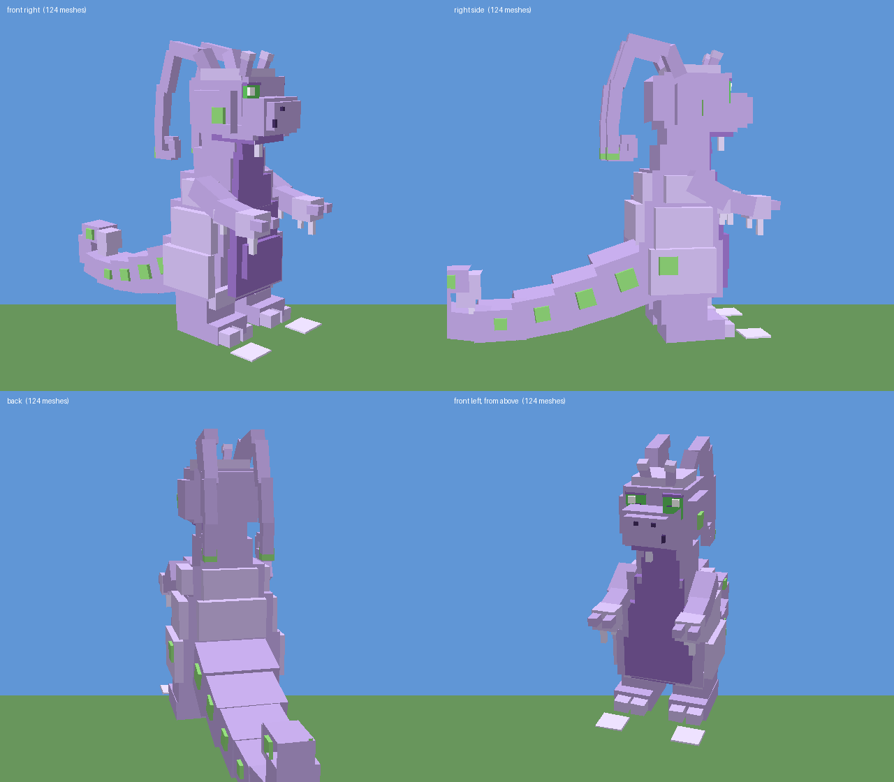
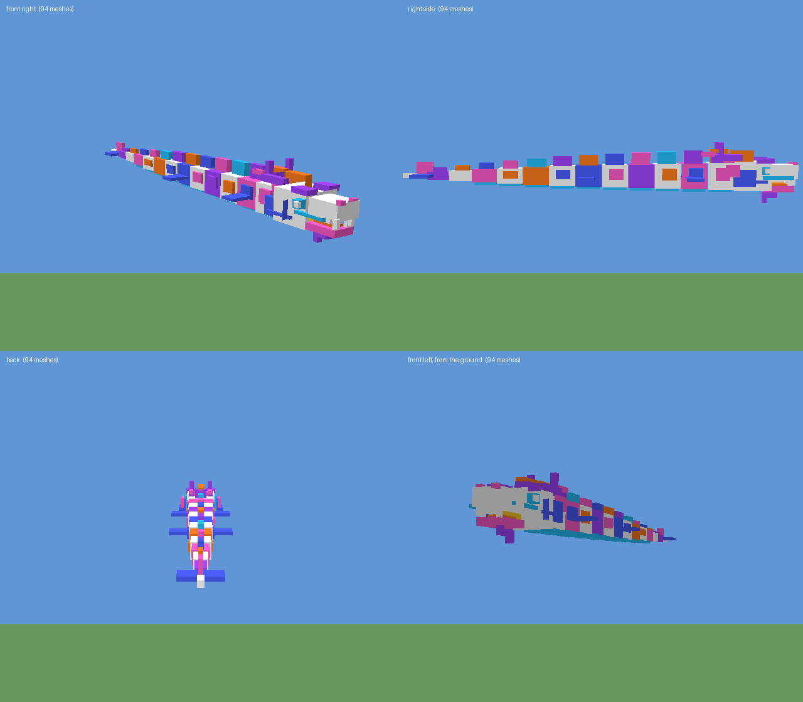

# Dragon Pulse for Bloxd.io

The move from `beam_blast_frames/`, rebuilt for [bloxd.io](https://bloxd.io) with
mesh entities, particles and code.


*Drawn by `dragon_pulse/tools/render.py` from a test run outside the game. It is a
rough picture, not a screenshot.*

## Install

1. Open your world, press **F8** and paste all of
   [`dragon_pulse/world_code.js`](dragon_pulse/world_code.js) into World Code.
2. Cast it one of three ways:
   - type `!dp` in chat;
   - place a Code Block, paste [`dragon_pulse/code_block.js`](dragon_pulse/code_block.js)
     into it and click it;
   - set `item` in `DP_CFG` to an item name, hold that item and right click.

A summoning circle draws itself on the floor 4 blocks in front of you. After 2.5
seconds the dragon comes up out of it, dashes 16 blocks into the air, circles
there while it finds a target, then dives onto it and kills it. The target is:

1. the mob or player you were looking at when you cast;
2. otherwise the mob nearest to the circle within 40 blocks;
3. otherwise the nearest other player (`hitPlayers: false` turns this off);
4. with nothing in range, the spot you were looking at.

**Two dragons that touch merge.** One dragon 2.2 times the size is left. It climbs
22 blocks and explodes as a giant beam (the nuke) that kills every mob and player within 44
blocks, except the players who cast the two dragons. Dragons touch when their
paths cross, for example when two players cast at each other at about the same
time, or one player casts twice in a row. `merge: false` turns this off.

If your World Code already has `tick`, `onPlayerChat` or `onPlayerAltAction`, do
not paste the three callbacks at the bottom. Put the one line inside each into
your own callback instead.

## Goodra

The Pokemon that fires the move in frame 01 is Goodra.
[`dragon_pulse/goodra.js`](dragon_pulse/goodra.js) builds it from 125 Box meshes.



*Drawn by `dragon_pulse/tools/render_model.py` outside the game: a rough picture,
not a screenshot.*

Paste `goodra.js` into World Code **below** `world_code.js`. It also works alone.

| Chat | What happens |
|---|---|
| `!goodra` | Goodra stands where you are, facing the way you look |
| `!goodra pulse` | It casts Dragon Pulse: the summoning circle appears on the floor in front of it |
| `!goodra off` | It is removed |

Every mesh is one named row in `GOODRA_MESH`, in 11 groups: `head`, `face`,
`antennae`, `neck`, `torso`, `belly`, `arms`, `legs`, `tail`, `spots`, `slime`.
Parts that exist on both sides are written once and mirrored.

`GOODRA_CFG` sets the size (`scale`, 0.6 is about 4 blocks tall) and the number of
parts (`detail`): 1 is the body and eyes with 51 meshes, 2 adds face, spots and
belly for 92, 3 is everything with 125.

The eyes stand out from the head and glow, so they show from the ground and at
night.

Not tested in the game either. Two things to look at:

- **Mesh limit.** The game does not publish how many mesh entities a world may
  hold. If it refuses one, Goodra stops there and tells you in chat how many parts
  are missing. Lower `detail` then.
- **Mesh turning.** Goodra is turned to face you and some parts are tilted, with
  the same call the dragon uses. If parts sit at odd angles, set `rotate: false`:
  it then faces north, east, south or west and nothing is tilted.

`!goodra off` removes the Goodra this World Code made. If you save World Code
again while one stands, that one stays: remove it first.

## Skins made of node meshes

[`dragon_pulse/skin.js`](dragon_pulse/skin.js) dresses a player in meshes that are
attached to the body parts ("nodes") of the player model, so they move with the
player by themselves. Paste it into World Code, alone or below the other files.

| Chat | What happens |
|---|---|
| `!skin goodra` | You wear Goodra: lilac body, green eyes and spots, antennae, belly, tail |
| `!skin dragon` | You wear the Dragon Pulse dragon: glowing white, horns, crest, whiskers, spines, fins, tail |
| `!skin off` | The skin is taken off |


*Drawn outside the game on a guessed player shape. The other skin is in
`dragon_pulse/preview/skin_dragon.png`.*

Each skin is a list in `SKINS`, 37 parts each. One row is one Box:

```
[node, width, height, depth, colour, right, up, front, flags]
```

- node: `HeadMesh`, `TorsoNode`, `ArmRightMesh`, `ArmLeftMesh`, `LegRightMesh` or
  `LegLeftMesh`.
- right, up, front: where the middle of the box is, in blocks from that node.
- colour: a name from `SKIN_COL`.
- flags: `x` is an extra (see below), `m` makes it twice, mirrored left and right,
  `g` makes it glow.

To make your own skin, add a list to `SKINS` under a new name: `!skin` and that
name then wears it.

`SKIN_CFG`: `chat` is the chat word, `extras` turns the extra parts on or off,
`front` is 1 or -1 (see below), `scale` resizes every part, `hideDist` is how far
away it is seen.

Not tested in the game. The documentation leaves three things open:

- **How many meshes a node holds.** If the game keeps only one per node, you see
  six plain boxes: the first six rows of a skin, one per body part. The code
  attaches those last so that they are the ones that stay. The other rows are the
  extras (face, antennae, tail and so on) and only show if the game keeps several.
- **Where a node is.** The offsets assume the head node is at the neck, the arm
  nodes at the shoulders, the leg nodes at the hips and the torso node in the
  middle of the torso. If a part sits too high or too low, change the `up` number
  of its rows.
- **Which way is front.** If the face and belly are on your back, set `front: -1`.

The meshes sit over your own skin; they do not hide it.

## Size

| File | Goes into | Characters | Limit |
|---|---|---|---|
| `world_code.js` | World Code | 44,585 | 512,000 |
| `goodra.js` | World Code, below `world_code.js` | 10,215 | 512,000 together: 54,801 |
| `skin.js` | World Code | 6,032 | 512,000, all three together: 60,834 |
| `code_block.js` | Code Block | 18 | 32,000 |
| `studio/particles_only.code_block.js` | Code Block | 6,430 | 32,000 |

The files to paste hold no `//` comments, to save space. What the settings and
the table columns mean is written on this page instead.

## How the move runs

| Step | What happens | Built from | Seconds |
|---|---|---|---|
| circle | The summoning circle draws itself ring by ring; the star in it turns. Then six more circles appear above it, one after another going up, each smaller than the one below and turning the other way | 88 mesh entities: 82 meshes in 13 rings for the main circle and 6 ring particle emitters for the circles above it; a smooth 16-sided outer band with a thin inner band, dashes and dots between them like runes, an octagon, a turning six-pointed star whose points touch it, a hexagon and a square turning the other way, eight spikes outside, a core over a turning plate, and a 7-block-tall cone of six circles above; rising sparks | 0.0–2.5 |
| emerge | A pillar of light, then the dragon comes up through the floor and spirals 16 blocks up | 113 meshes: a 55-part head and a 58-part body that follows the head's path. The five cloud orbs beside it and the trail behind it are particles | 2.5–3.15 |
| seek | It circles at the top, then picks its target; a ring flashes on the target | the same dragon | 3.15–3.75 |
| dive | It weaves down onto the target | the same dragon, shimmer particles | 3.75–4.7 |
| coil | It wraps round the target; two stars flash | no meshes: each star is 48 particles placed along 12 rays, plus sparks | 4.7–5.3 |
| beam | The dragon turns into a massive round black beam that shoots 72 blocks straight up from the target | 22 meshes: an eight-sided black core (four boxes turned 45° apart), six thin red and purple beams round it, an eight-sided disc at the foot, two eight-sided collars travelling up; a ball of particles on the tip, rising sparks | 5.35–5.85 |
| second beam | A second beam rises around the first in a fifth of a second and waits: the two throb and slowly thicken (about 9 blocks across) while light is pulled in at the foot and down from the tip | 8 more meshes: eight bars in a circle round the first beam, near-black and red in turn; gathering glints, a red glow | 5.85–6.65 |
| collapse | It all comes down: both beams sink from the top into the ground in 0.3 s and get twice as thick while they do | the same 30 meshes, still round; streaks racing down | 6.65–6.95 |
| blast | It explodes on the ground: a round burst: a ball with 22 spikes all round bursts out to 20 blocks across, four waves of particles spread out in a circle over the ground to the blast radius, a dome of particles flies up and out, then a dome of smoke, three shock rings of particles widen at three heights out to the blast radius, then the star shrinks away. The target is killed at the first moment, others within 16 blocks are hurt and pushed | 16 meshes (`blast`): a 3-box ball and 13 ray boxes. The waves on the ground are 48, 40, 40 and 32 particles, each placed on its circle. The rings are 40, 32 and 24 particles, each placed on its circle; flashes, debris, embers, shock waves | 6.95–7.8 |
| smoke | A ball of dark smoke swells and rises, with a ring of dust rolling out | no meshes: 26 + 14 + 14 smoke particles placed on spheres and 20 on the dust ring, plus sparks | 7.8–9.6 |

After two dragons touch, the one that is left runs these steps instead:

| Step | What happens | Built from | Lasts |
|---|---|---|---|
| mega | The merged dragon, 2.2 times the size, spirals 22 blocks up | the same 113 meshes, bigger | 1.2 s |
| beam | A beam more than twice as thick again shoots from the ground up through the dragon and 50 blocks past it | the same 22 meshes, bigger | 0.6 s |
| nuke | A second beam joins it and waits about a second, both sink into the ground (up to 15 blocks thick), then it explodes: a burst about 60 blocks across and three shock rings out to the kill radius. Everything within 44 blocks dies | the same meshes as the blast, three times the size | 2.2 s |
| cloud | Smoke where the beam stood and rings of dust rolling out along the ground | no meshes: smoke balls of 40 and 24 particles and dust rings of 36 | 2.5 s |

How long the dive takes depends on how far the target is. The clip in
`beam_blast_frames/` started this move (orbs, beams, a white dragon); the circle,
the purple dragon and the nuke are changes asked for later.

## The meshes

Every mesh is one row in `DP_MESH` in `world_code.js`:

```
[name, width, height, depth, colour, forward, right, up, flag]
```

| Group | Rows | What it is |
|---|---|---|
| `pillar` | 1 | The pillar of light when the dragon comes out |
| `head` | 55 | Dark purple skull and a snout that narrows to the tip; open lower jaw with its own tip and hinges; black horns in three pieces with magenta tips; a three-step crest; glowing red eyes in black sockets with slit pupils under heavy brows; a nose horn, snout ridge and forehead gem; big and small fangs, teeth, tongue and a glowing throat; whiskers, nostrils, mane, cheek fins with frill spikes, chin spikes, beard |
| `body` | 58 | 12 segments from thick neck to thin tail, dark purple and near-black in turn; a tall magenta spine on each, bright violet belly plates, red stripes on both sides, a pair of wings with violet tips, a pair of fins, tail fins |
| `beam` | 10 | The beam before each explosion: an eight-sided core (4 boxes) and six thin beams round it |
| `beam2` | 8 | The second beam that waits before the explosion: eight bars in a circle |
| `blast` | 16 | The explosion on the ground: a ball (3 boxes) and 13 ray boxes that make 22 spikes |
| `beamTop` | 3 | A spare ball, one slice of the disc at the beam's foot (used 4 times), and one slice of a collar (used 8 times, two collars) |

Each beam also has a shock ring of 10 meshes that widens on the ground. It is
made in code by `dpShock`, not from a table.

Meshes cannot be see-through in Bloxd, so the mesh trail fades by getting
thinner and darker. The particles behind it do fade out.

To change a part, change its row. To add one, add a row: the engine picks it up.

Every row in `DP_MESH` is named `M`. What each row is, in order:

- `beam`: the four core boxes, front, back, then the four side beams.
- `beamTop`: ball, foot slice, collar slice.
- `body`: for each of the 12 segments from neck to tail tip, the segment itself,
  then its spine, then (where it has them) its belly plate, side stripes, and
  wings or fins. The wing tips follow the wings. The last three rows are the tail
  fins, the tail's top fin and its tip.
- `head`: skull, snout, snout tip, jaw, horns, crest, eyes, cheek fins, jaw tip,
  second horn pieces, front and back of the crest, eye sockets, brows, upper
  fangs, lower fangs, throat, nose horn, snout ridge, whiskers, forehead gem,
  mane, jaw hinges, horn tips, pupils, upper and lower frill spikes, small fangs,
  teeth, tongue, nostrils, whisker tips, back of the mane, chin, beard, chin
  spikes.

The numbers are meshes made at full detail; parts on both sides are written once
and mirrored. `detail` in `DP_CFG` sets how much of the dragon is made: 1 gives 28
meshes, 2 gives 74, 3 gives 113 (head and body).

The summoning circle is in `DP_CIRCLE`. One row is one ring of equal boxes:

```
[count, radius, length, width, height, colour, turn, up, tick, spin, flag]
```

- count boxes stand round the middle at radius, each length long, width wide and
  height tall.
- turn: degrees the whole ring is turned. up: blocks above the floor.
- tick: when the ring appears, in ticks (20 per second) after the cast.
- spin: how far the ring turns each tick; 0 stands still.
- flag `spin`: the boxes turn by themselves (the runes and the core). Flag `r`:
  the boxes point away from the middle instead of along the ring. Flag `k`: the
  ring stays while the dragon comes out. Flag `e`: the ring is a particle emitter
  instead of meshes.




*Drawn outside the game with plain light so the parts can be told apart. In the
game they glow.*

The move stays under 400 meshes. One cast holds at most 145 meshes at once (circle and dragon together, while it
comes out); two dragons about to merge hold up to 286. To fit, the
circle is cut down to 40 meshes (outer band, star, core and the two lowest of
the circles above: the rings with flag `k`) at the moment the dragon starts to come out. `maxMeshes` is 399, and the
meshes of a standing Goodra count toward it, so the code never asks for a 400th. All are deleted when the move ends.

## Node meshes (an experiment, off by default)

A node mesh is a box that hangs on another entity and moves with it. It is not a
mesh entity, so it does not count toward the limit. With them on, each rigid
group becomes one mesh entity that carries the rest:

| | Mesh entities | With node meshes |
|---|---|---|
| Summoning circle | 88 | 11 (5 carriers with 82 node meshes, and the 6 ring emitters) |
| Dragon head | 55 | 1 carrying 55 |
| One cast at most | 145 | 72 |

The body, orbs and trail bend along the flight path piece by piece, so they stay
mesh entities. With node meshes on, the whole circle stays while the dragon comes
out, and a cast makes about a third fewer api calls per tick.

Type `!dp nodes box` to turn it on, `!dp nodes person` for the second way, and
`!dp nodes off` to go back. Or set `nodes` in `DP_CFG` to `"box"` or `"person"`.

**This is not tested in the game and may show nothing.** The documentation only
describes node meshes on a player's six body nodes. Two things are unknown:

- Whether a Box mesh entity has a node to hang things on. `box` uses a tiny box
  as the carrier and hangs everything on its `TorsoNode`. If the circle and the
  head are invisible, try `person`: the carrier is then a `Person` mesh, which
  has the body nodes for sure, but you will see a person standing in the circle
  and one flying where the head is.
- Whether one node holds many meshes. If the game keeps only one, you see a
  single piece of the circle and of the head.

If neither way works, leave it off: the move then runs as before.

## The particles

The 21 particle looks are in `DP_FX` in `world_code.js`, in seconds and blocks.

| Look | Where it shows |
|---|---|
| `ember` | Small squares that start white, turn to colour and drift up: off the circle, off the dragon's body, around the beam, over the smoke |
| `streak` | Fast thin glints in one direction: speed lines behind the dragon's head, lines racing up the pillar and the beam |
| `gather` | Glints that fly inward from a ring: energy pulled into the circle, the lock-on closing on the target, the merged dragon charging |
| `debris` | Bright bits thrown up that fall back: when the dragon breaks out of the floor and when the beam explodes |
| `shock` | True rings that spread outward (see `dpRingFx`): at the foot of the beam, at the explosion, at the beam's top, around the stars, at the merge |
| `glow` | A few large soft squares for one flash: beam tip, explosion, stars, lock-on, merge |

`dpRingFx(look, pos, radius, count, out, lift, tint, tint2, points, turn)` plays a
look from `points` places on a circle, each flying outward (`out` 1) or inward
(`out` -1). `dpColumnFx` fills the beam's whole height with streaks and embers and
winds three spark points up around it. One cast plays at most about 170 particles
in a tick, two about 190.

### Particles in place of meshes

Some effects that used to be meshes are now built from particles that are each
placed at an exact point with an exact speed, the way the Particle Studio does
it. That frees 30 meshes on the dragon, 36 in the ritual circle and up to 50 more at
the end of the move.

| Effect | Before | Now |
|---|---|---|
| Cloud orbs beside the dragon | 20 meshes | 9 dark puffs on a small sphere and a red glint, drawn again every quarter second where the orb is |
| Trail behind the tail | 10 meshes | 5 particles a tick along the path, each smaller than the one before |
| The two bite stars | 12 meshes | 48 particles on 12 rays that fly outward, the far ones faster |
| Shock rings of the blast | 30 meshes | 40, 32 and 24 particles on three circles that widen to the blast radius |
| The six circles above the ritual circle | 42 meshes | 6 ring particle emitters, one entity each (see below) |
| The ball on the beam's tip | 1 mesh | 10 particles on a small sphere, drawn again every tick |
| Smoke and dust | 20 meshes | smoke on spheres that swell and rise, dust on a widening ring |

The dragon, the ritual circle, the beams and the star of the blast are still
meshes: they need hard edges and must stay still or turn exactly, which
particles cannot do.

`dpShape(look, at, directions, radius, grow, tint, tint2, rise)` places one
particle per direction, `radius` from `at`, flying outward at `grow` blocks a
second. `dpBall(n)` gives `n` directions spread evenly over a sphere and
`dpRing(n, turn)` gives `n` round a circle. The looks are `cloud`, `ray`,
`front` and `puff` in `DP_FX`. The cost is one api call per particle; a tick
makes at most about 100 particle calls.

### Ring particle emitters

The six circles above the main ritual circle are `ParticleEmitter` mesh entities
with `emitterShape: "ring"`: the game itself keeps emitting particles round the
ring, so each circle is one entity and needs no calls after it is made. The main
circle on the floor is still meshes. `dpEmitter(radius, colour)` builds the
options; rows of `DP_CIRCLE` with flag `e` use it.

`ringDensity` in `DP_CFG` (3) sets how many particles the circles give off: the
largest gives off about 460 a second and the smallest about 160. Raise it for
thicker rings, lower it if the game slows down.

Set `ringParticles: false` in `DP_CFG` to get the mesh circles back. The code
also switches back by itself if the game throws an error when the first emitter
is made. Not tested in the game: how thick and how bright the rings look depends
on how the game draws the emitter, and may need the numbers in `dpEmitter`
changed (`emitRate`, `minSize`, `maxSize`, life).

### The vortex round the dragon

Two `ParticleEmitter` mesh entities ride on the dragon and pour out dark
particles. One sits near the head and one further down the body, on opposite
sides, and both circle the body as it flies. The particles stay where they were
let go, so when the dragon spins (coming out of the circle, circling above, and
coiling round the target) they draw a dark vortex. `dpVortex` moves them and
`dpVortexLook` holds the look. They count as 2 of the mesh entities.

Set `vortex: false` in `DP_CFG` to turn it off. Not tested in the game: the
vortex only shows if the game leaves particles behind when an emitter moves.
If the particles move along with the emitter instead, it will look like two
dark balls circling the dragon.

### Round shapes from boxes

The game only has box meshes, so a round shape is made from long boxes that
cross in the middle: four boxes turned 45° apart give eight sides, six boxes
turned 30° apart give twelve. The beam's core, its foot and its collars are built this way. A row of `beam` can carry its
turn in degrees as a tenth value; rows of `blast` take their direction from
`DP_DIAG` by flag letter.

### The Particle Studio scene

`dragon_pulse/studio/dragon_pulse.scene.json` holds these four effects (orb,
star, shock rings, smoke) side by side. Open
https://epicoo00000.github.io/Bloxd-Particle-studio/, press Open and pick the
file to look at them and change them. The scene loads unchanged in the studio's
own code (219 particles). It is a copy for looking and editing: changing it
does not change `world_code.js`. Send the changed file back and the numbers can
be carried over.

## The sounds

`DP_SND` in `world_code.js` holds one row per moment. Each row is a list of
sounds played together: `[name, volume, speed]`. Names are from the game's sound
list.

| Row | When | Sounds |
|---|---|---|
| `cast` | the cast | a low bell and a magic accent |
| `ring` | each ring of the circle appears | a harp note, higher each time |
| `pulse` | every half second while the circle is drawn | a low drum, faster in pitch each time |
| `build` | 1.2 s before the dragon comes out | a rising tone |
| `emerge` | the dragon comes out | a deep roar, an impact and a drum swish |
| `lock`, `dive` | it has its target and dives | a roar, a beep and a swish |
| `beam` | the beam shoots up | a pulse and a zap |
| `blast` | the explosion | a cannon and a bass hit |
| `merge`, `climb` | two dragons merge | a pulse, a very deep roar, a zap and a rising tone |
| `nuke` | the nuke | three slowed-down blasts together |
| `rumble` | the cloud | a slow low drum, five times |

## Settings

`DP_CFG` at the top of `world_code.js`:

| Setting | Meaning |
|---|---|
| `chat` | Chat message that casts the move. `""` turns it off |
| `item` | Held item that casts it on right click. `""` turns it off |
| `range` | Blocks around the circle in which the dragon finds a target |
| `summon` | Seconds the circle is drawn before the dragon comes out (2.3 at least) |
| `circleDist` | Blocks in front of the caster where the circle appears |
| `rise` | Blocks the dragon flies up out of the circle |
| `hitPlayers` | `false`: the dragon only goes for mobs |
| `kill` | `true`: the target dies, and so does everything the nuke reaches. `false`: they take `damage` or `nukeDamage` |
| `damage` | Health taken at the centre of the blast from everyone but the target |
| `boom` | Size of every beam and its smoke. 1 is as drawn here, 2 is twice as big. It does not change who is hit |
| `beam` | Seconds the first beam takes to shoot up |
| `hold` | Seconds the second beam waits before both explode and hurt. The nuke waits a fifth longer |
| `radius` | Blast radius in blocks |
| `knockback` | Push away from the blast |
| `hurtCaster` | `true`: blast and nuke also hit whoever cast the dragons |
| `merge` | `false`: dragons that touch do not merge |
| `mergeDist` | How close two dragons must come to merge, in blocks |
| `megaScale` | Size of the merged dragon |
| `megaRise` | Blocks the merged dragon climbs before it explodes |
| `nukeRadius` | Radius of the nuke in blocks, measured along the ground |
| `nukeDamage` | Health the nuke takes at its centre when `kill` is `false` |
| `nukeKnockback` | Push away from the nuke |
| `rotate` | Turn meshes to face the way they fly |
| `sounds` | Play sounds |
| `hideDist` | Players further away than this many blocks do not see it |
| `maxCasts` | Casts that may run at once in the world |
| `detail` | 1, 2 or 3: how many parts the dragon has |
| `maxMeshes` | Mesh entities all running casts may hold together |

`GOODRA_CFG` at the top of `goodra.js`:

| Setting | Meaning |
|---|---|
| `chat` | The chat word, `!goodra` |
| `scale` | Size. 1 is 6.8 blocks tall, 0.6 about 4 |
| `detail` | 1, 2 or 3: how many parts are made |
| `rotate` | Turn and tilt the meshes. `false`: it faces north, east, south or west |
| `perTick` | Meshes made per tick while it is being built |
| `hideDist` | Players further away than this many blocks do not see it |

## The table columns

**`DP_MESH`** (the move): `[name, width, height, depth, colour, forward, right, up, flag]`

- width is left to right, height bottom to top, depth along the flight.
- forward, right, up: where the part sits, in blocks from the middle of its group.
  In `body`, forward is how far behind the head the part follows (negative). In
  `smoke`, it is where the puff ends up.
- colour: a name from `DP_COL`.

### Colours

`DP_COL` holds every colour as red, green, blue from 0 to 255.

- **The ritual** uses only the dark ones: `void` (black) for the plate, `wine`
  (dark purple-red) for the outer band, `blood` (dark red) for most rings, and
  `crimson` (bright red) for the star and the core. The circles above take those
  three in turn. Its particles are red too (`DP_RITE`).
- **The dragon** is near-black (`night`) and black (`void`) with dark purple
  (`deep`) spines, crest and wings, dark red (`blood`) belly plates and wing
  tips, and red (`crimson`) eyes, whiskers and stripes. Only its fangs are white.
- **The explosion** is black and red: a black beam core with red and dark purple
  bars, a red and dark purple star, dark red shock rings, and smoke the colour of
  ash (`smoke`, `shade`).
- **Particles** are darkened in one place: `DP_DARK` swaps every bright colour a
  particle would use for a dark one (white and gold become red, pink becomes dark
  red, lilac and purple become dark purple). Empty it to get the bright
  particles back.
- name: every row is named `M`. The code does not use the name, so tell rows
  apart by their order, which is listed under "The meshes".
- flag: `spin` turns by itself, `lit` is shaded instead of glowing. `a`, `b`, `c`
  or `d` slants a ray along one of the four diagonals (`DP_DIAG`). `m` makes the
  part twice, mirrored left and right (write it for the right side). `2` or `3`
  makes it only at that detail level or higher.

**`GOODRA_MESH`**: `[name, width, height, depth, colour, forward, right, up, tilt, turn, lean, flags]`

- forward, right, up: where the middle of the part is, in blocks from the point on
  the ground between the feet, before `scale`.
- tilt, turn, lean: degrees. Tilt leans the top forward, turn turns it to its
  right, lean leans the top to its right. Leave them out for 0.
- colour: a name from `GOODRA_COL`.
- flags: `m` makes the part twice, mirrored left and right (write it for the right
  side). `2` or `3` makes it only at that detail level or higher. `g` makes it glow.

**`DP_FX`** (particle looks):

| Field | Meaning |
|---|---|
| `tex` | Texture name |
| `life` | Shortest and longest life in seconds |
| `size` | Smallest and largest size in blocks |
| `speed` | Slowest and fastest speed in blocks per second |
| `grav` | Pull in blocks per second squared. Up is + |
| `col` | The two colours a particle is mixed from. `"tint"` and `"tint2"` are given when it is played |
| `fade` | How solid it is at birth and at death, 0 to 1 |
| `blend` | 1 normal, 2 glow |
| `drag` | Share of its speed left at the end. 1 keeps flying |
| `flat` | 1: flies level, for rings |
| `hot` | 1: starts white, then turns to its colours |
| `tight` | 1: flies in a narrow cone, for streaks |

`DP_ORBS` holds where each cloud orb flies: blocks behind the head (negative),
to the right, and up. `DP_SKIN` holds the colour pairs the dragon shimmers in. `GOODRA_MOUTH`
is where Dragon Pulse leaves Goodra: forward, right, up.

## Not tested in the game

I could not run Bloxd from here. The code was run against a stand-in for the game's
`api` written from the [official API documentation](https://github.com/Bloxdy/code-api).
That checks sizes, that every call is well formed and that every mesh is deleted.
It cannot show how the game draws it. Things to look at first in your world:

- **Slanted rays and rings.** The slanted rays of the stars and the shock rings
  need mesh turning to work. With `rotate: false` they lie along the axes.
- **Mesh turning.** Meshes are turned to face the way they fly with
  `api.setEntityRotation`. The documentation does not say which way round the
  angles go. If the circle's lines or the dragon's parts point the wrong way, set
  `rotate: false`: the parts then stay level, in the right places.
- **Mesh limit.** The game limits mesh entities but does not publish the number.
  If parts of the dragon are missing, lower `detail`.
- **Many casts at once.** There is no cooldown. Up to `maxCasts` (4) casts run
  together and share `maxMeshes` (399). Two dragons need 286; a third at the same time is cut
  short.
- **Speed.** At full detail one dragon makes up to 330 api calls per tick, two
  up to 540. If the game stutters or stops the script, lower `detail`.
- **Killing.** The target is killed with `api.killLifeform`. If the game refuses
  that call, the code takes 99,999 health instead.
- **The nuke** does not break blocks.
- **Code block.** `code_block.js` calls a function defined in World Code. If your
  world reports that `dragonPulse` is not defined, use the chat word or the item.
- **Roofs and walls.** Under a roof the dragon stops rising below it. It flies
  through blocks on its way to the target. The parts of it still below the floor
  only stay hidden if the floor is solid.
- **Sounds.** I chose them by name; I could not listen to them. Change any row of
  `DP_SND` that sounds wrong.
- **Particle speed and blend.** Lifetimes and speeds assume the particle clock the
  studio measured (0.6 per second).

## Files

| Path | What it is |
|---|---|
| `beam_blast_frames/` | The 20 reference frames |
| `dragon_pulse/world_code.js` | The move. Paste into World Code |
| `dragon_pulse/goodra.js` | Goodra. Paste into World Code below the move |
| `dragon_pulse/skin.js` | Skins made of node meshes. Paste into World Code |
| `dragon_pulse/code_block.js` | One line for a code block that casts it |
| `dragon_pulse/studio/dragon_pulse.scene.json` | The four particle effects that replaced meshes, as a Particle Studio scene |
| `dragon_pulse/studio/particles_only.code_block.js` | That scene exported by the studio |
| `dragon_pulse/studio/build_scene.mjs` | Writes the scene and checks it with the studio's code |
| `dragon_pulse/tools/sim.mjs` | The test run: `node dragon_pulse/tools/sim.mjs --target`. It also runs two dragons that merge |
| `dragon_pulse/tools/goodra_check.mjs` | The test of Goodra: `node dragon_pulse/tools/goodra_check.mjs` |
| `dragon_pulse/tools/skin_check.mjs` | The test of the skins: `node dragon_pulse/tools/skin_check.mjs` |
| `dragon_pulse/tools/dragon_model.mjs` | Lays the dragon out straight for a drawing |
| `dragon_pulse/tools/render_model.py` | Draws Goodra and the dragon (needs Pillow) |
| `dragon_pulse/tools/render.py` | Draws the test run (needs Pillow) |
| `dragon_pulse/preview/` | The drawings (`circle.png` is the summoning circle alone) |
