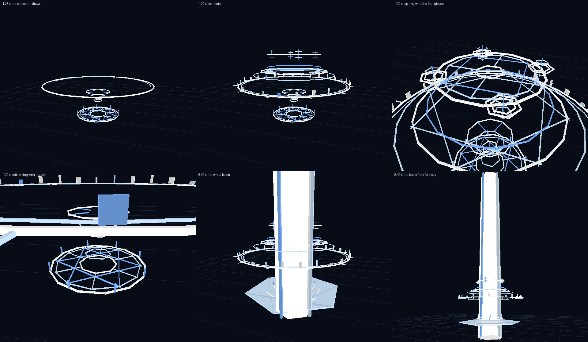

# Astral Circle

A stack of white magic circles draws itself in the air, charges, and ends in
a giant white beam. Rebuilt from one screenshot of a Minecraft magic mod
short. Sim-tested only; it has not been run in Bloxd.



The picture is drawn by `tools/render.py` from the test run: boxes only, no
particles. It is not a screenshot of the game.

## Use it

Either:

- **World Code:** paste `world_code.js` (about 15,000 characters), then type
  `!astral`. The circles form 15 blocks in front of you. If other world code
  is there too, paste this **after** it.
- **Code Block, no World Code needed:** paste `code_block.js` (15,411 of
  32,000 characters) into a Code Block and click it. The circles form above
  the block. This relies on the game calling a `tick` that a code block
  assigned, which is not documented; if it does not, the second click says so
  in orange chat.

From other code: `astralCircle(playerId)` or `astralCircle(playerId, [x, y, z])`.

## What happens (6.75 s)

| Seconds | What |
|---|---|
| 0.0–3.8 | The circles are drawn piece by piece, from the bottom ring up: 5 meshes every tick |
| 3.8–5.0 | Charge: the globes and the rune belt turn up to five times faster, sparks are pulled to the middle, and a hair-thin white line appears down the centre |
| 5.0–5.25 | The line opens into a white beam 4.5 blocks wide and 44 tall; a flare spreads over the floor to 6 blocks out |
| 5.1 | Everyone within 5 blocks of the centre takes 60 damage and is thrown outward. The caster is never hit |
| 5.0–6.5 | The beam holds and flickers, with four streaks turning round it; the small rings inside it are removed |
| 6.1–6.5 | The beam thins out |
| 6.5–6.75 | Everything is deleted, 60 meshes a tick |

## The model

The whole thing is 15 blocks across and 10 tall (half the first version), with
more parts per ring.

| Part | Meshes | What |
|---|---|---|
| 15 rings | 202 | Flat rings on 10 heights, from 1 to 9.5 blocks up, 0.6 to 7.5 blocks in radius; the bottom ring, the belt and the top ring are double lines (`AC_RING`: radius, height, pieces, thickness, colour) |
| 3 stars | 18 | Lines drawn inside rings: a six-pointed star in the bottom ring, an eight-pointed one in the upper ring, a square in the top ring (`AC_STAR`: radius, height, points, skip, thickness, colour, turn) |
| Spokes and ticks | 27 | 12 tick marks sticking out of the belt, 4 spokes in the top ring, 6 in the bottom ring, 5 in the small disc (`AC_SPOKE`: from radius, to radius, height, count, thickness, colour, turn) |
| Pins | 8 | Short upright posts round the bottom ring (`AC_PIN`) |
| Rune belt | 28 | Small upright plates of 8 shapes standing on the widest ring, turning slowly (`AC_BELT`, `AC_RUNE`) |
| 4 globes | 96 | On the top ring: each a small circle (6) with a wire globe inside (hoops of 5, 6 and 5, and a pole). They travel round the ring (`AC_ORB`) |
| Beam | 13 | White column of 3 crossed boxes, 4 streaks, 2 floor flares of 3 boxes each (`AC_BEAM`) |
| **Total** | **392** | Under the 400 limit; `maxMeshes` is 399 |

Spawning: 5 meshes a tick, which is 100 a second, under the 120 a second you
mentioned. The beam's 13 boxes are created 3 a tick during the charge, as the
thin line, so nothing is created in a burst. If the real cap is lower, lower
`spawnPerTick`; the build just takes longer.

Every box is level (only turned left or right), so the look does not depend
on which way the game tilts meshes.

## Settings (`AC_CFG`)

| Name | Meaning |
|---|---|
| `chat` | Chat command (`!astral`) |
| `range` | Blocks in front of the caster where it forms (15 at most) |
| `size` | Scale of the whole thing (1) |
| `damage`, `radius`, `knockback` | The hit: 60 damage within 5 blocks of the centre |
| `hitPlayers` | false = mobs only |
| `spawnPerTick` | Meshes created per tick while drawing (5) |
| `hold` | Ticks of charge between the last piece and the beam (24) |
| `beamWidth`, `beamTicks` | Beam width in blocks (4.5) and how long it lasts (30 ticks) |
| `sounds`, `hideDist`, `maxCasts`, `maxMeshes` | Sounds on, draw distance 220, one cast at a time, 399 meshes |

Colours are in `AC_COL`, sounds in `AC_SND`.

## Not known

- Whether the spawn cap is really 120 a second, and whether it counts per
  second or per tick.
- How the reference looks in motion: only one frame was available, so the
  turning speeds, the charge and the beam are my own design.
- The thin "double line" look of the reference is done with two rings of
  different radius; glow and transparency are not possible with box meshes.

## Check it

```
node tools/check.mjs --dump /tmp/astral.json
python tools/render.py /tmp/astral.json preview/moments.png
```

`code_block.js` is generated from `world_code.js` by `tools/check.mjs`; do not
edit it by hand.
