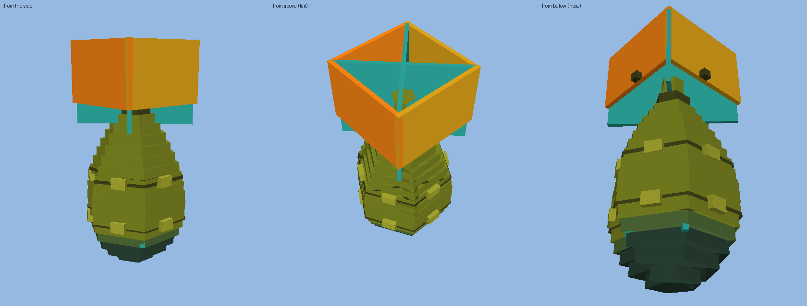

# Bomb (mesh model)

A bomb like the picture: olive egg-shaped body with a dark nose, two bands with lugs, and a square gold/orange tail box with teal fins inside. 88 meshes, about 4.8 blocks tall and 2 wide.



The picture is my own render, not a Bloxd screenshot. **Not run inside Bloxd yet.**

## How to use it

Paste `code_block.js` (3,855 characters) into a code block and click it. The bomb appears above the block, standing nose down. Click again to remove it. It works by itself; no World Code is needed.

## Drop it on someone: `!target <name>` (World Code)

Paste `world_code.js` into World Code and type `!target <player name>` in chat. Capitals do not matter and the start of the name is enough.

1. The bomb appears 45 blocks above that player and falls for 2.5 seconds, faster and faster, with a smoke trail and a red mark on the floor. It follows the player if they run.
2. When it lands: white-yellow fireball, a shock ring racing outward, then a mushroom column and cap of fire and smoke for 2 seconds.
3. The target is killed (credited to you). Everyone else within 9 blocks, mobs included, takes 18 to 60 damage depending on distance, and everyone hit is thrown up and away. That includes you if you stand too close.

Settings are in `NUKE_CFG` at the top: `dropHeight`, `fallTicks`, `follow`, `killTarget`, `blastRadius`, `blastDamage`, `knockback`, `hitCaster`, `hitMobs`, `sounds`, `maxBombs` (3). Anyone can use the command; there is no admin check. From your own code: `nukeTarget(senderId, targetId)`.

Not sure until tried in Bloxd: how big and bright the explosion particles look, and how the three sounds used (cannon, firecracker, rocket engine) come across.

Test: `node tools/drop_check.mjs`

## Settings of the code block (`bombSettings`, first line)

| Name | Default | Meaning |
|---|---|---|
| `scale` | 1 | size; 2 = twice as big |
| `lift` | 1 | blocks between the block and the nose |
| `turn` | 0 | turn left/right, in radians |

## Good to know

- It stands straight up (nose down), not tilted like the picture. Every piece is a level box that is only turned left or right, which is what has worked in game so far.
- The colours are flat; the green-to-orange light in the picture is not copied.

## Test

```
node tools/check.mjs --dump boxes.json
python tools/render.py boxes.json preview/bomb.png
```
