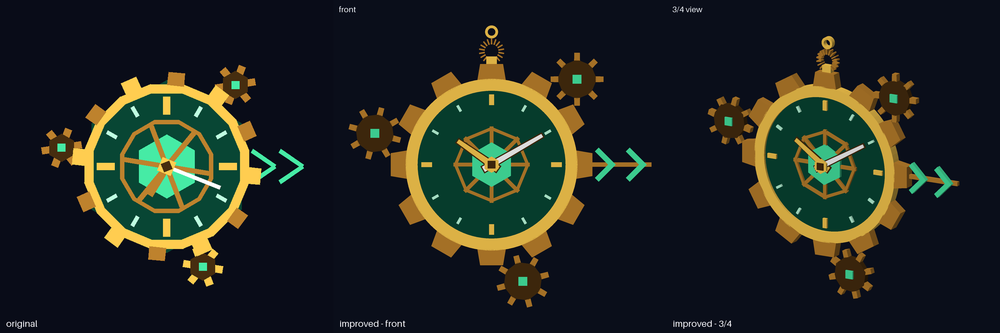

# Steampunk Clock — improved Bloxd model

A rebuild of the flat-vector clock in `supersuperdupercoolclock.png` as a real
**glTF 2.0 binary (.glb)** model for Bloxd, generated programmatically so every
proportion and colour is an explicit, tweakable parameter.



| file | what it is |
| --- | --- |
| `steampunk_clock.glb` | wall-decoration variant, 3.52 × 3.29 × 0.26 units |
| `steampunk_clock_item.glb` | item variant, baked into Bloxd's 8 × 8 × 1 item box |
| `pack/models/Compass.glb` | drop-in texture-pack override (the item variant) |
| `pack/_json/steampunkClock.json` | texture-pack manifest, base64-embedded model |
| `build_clock.py` | the generator — geometry, materials, previews, pack output |
| `preview_front.png`, `preview_34.png`, `preview_comparison.png` | renders |

Regenerate everything with:

```bash
.venv/bin/python clock_model/build_clock.py
```

Requires `pillow` and `numpy` (numpy is used only by the z-buffer preview renderer).

---

## What was wrong with the reference, and what changed

The reference is a strong flat illustration but it breaks down as a 3D object.
Each problem below was a deliberate design decision, not an incidental port.

**1. Gear teeth were inconsistent and unsynced with the dial.**
The reference's teeth have visibly different widths and sit at arbitrary angles
relative to the hour markers. Here the 12 bezel teeth are generated from a
single `gear_outline()` call with one tooth per hour position
(`phase = clock_math_angle(0)`), so teeth and markers share exactly one angular
grid. Twelve-fold symmetry is now structural, not eyeballed.

**2. The bezel was one flat gold colour.**
Sampling the reference's pixels shows the teeth are actually a *bronze/copper*
tone (`#BE822D`) sitting on a *gold* ring (`#FFCD50`) — the flatness in the
original is a rendering artifact of the smaller image. The bezel is now built as
a true annulus plus 12 separate copper tooth extrusions, which is both more
faithful to the source palette and gives the silhouette depth at the tooth roots.

**3. The satellite gears neither meshed nor sat in a deliberate pattern.**
In the reference the three small gears float at uneven radii with teeth that
would collide if they ever turned. Three changes:

- Even 120° spacing at clock 45° / 165° / 285°, all at one radius.
- Their distance (`SAT_DIST = 1.406`) and tooth phases (0° / 15° / 30°) were
  *solved numerically* — see the calibration note below — so a satellite tooth
  enters a bezel gap with no polygon overlap. It reads as a working gear train.
- Bodies are brown octagons with separate copper teeth and a small mint square
  core, matching the sampled source rather than the reference's ambiguous blobs.

**4. Hands were thin, uneven, and vanished against the web.**
Hands are now tapered trapezoids on a proper stacked z-order (hour → minute →
hub) in a classic 10:10 pose. Critically, the reference's hands sit at almost
the same *value* as the copper spokes, so they disappear at a glance. Each hand
gets a slightly oversized dark silhouette underneath it (`OUTLINE_PAD_W`), which
acts as a drop shadow and keeps the hand legible over the mint centre and the
copper web at any zoom level.

**5. Hour markers were irregular in length and spacing.**
Two-tier hierarchy instead of one: gold cardinals at 12/3/6/9 (0.125 × 0.058)
and light-mint minors for the other eight (0.082 × 0.032), all on one ring
radius (`R_MARK`). This is the single biggest readability win — the dial now
tells the time at a glance.

**6. The chevrons floated in empty space.**
This was the reference's most obvious compositional problem: two glyphs
unattached to anything. They are now threaded onto a **copper mount rod** that
runs out of the bezel (with a collar where it enters), so the accent reads as an
exhaust or gauge mechanism bolted to the case instead of stray decoration.

**7. It did not read as an object.**
Added a layered relief stack (backplate → bezel → dial → markers → web → hub,
`Z_*` constants) and a **winding crown + bail loop** at 12 o'clock. The crown is
18 knurled copper ridges around a gold barrel, recessed to the back of the dial
plane so the knurls never wash out into the bezel behind them. This is what makes
it read as a pocket watch rather than a circular sticker.

---

## Colour palette

All values sampled from the source PNG (region censuses, not single-pixel probes
— the earlier `#33A679` reading for the chevrons turned out to be an antialias
edge, the true colour is `#46EBA5`).

| token | hex | used for |
| --- | --- | --- |
| `gold` | `#FFCD50` | bezel ring, cardinals, hour hand, hub, stem, crown, bail |
| `face` | `#084634` | dial |
| `back` | `#090C18` | backplate |
| `mint` | `#46EBA5` | centre hexagon, satellite cores, chevrons |
| `mintlt` | `#BEFFE1` | minor hour markers |
| `copper` | `#BE822D` | bezel teeth, octagon web, spokes, crown knurls, mount rod |
| `brown` | `#462D0F` | satellite bodies, hub pin, hand outlines |
| `white` | `#FFFFFF` | minute hand |

Materials are plain PBR metallic-roughness with no textures, so the model is
8 primitives / 8 materials and stays under 1 MB.

---

## Numbers

```
triangles      3632          (Bloxd budget ~12,000, 6–8k preferred)
file size      ~260 KB GLB   (limit 2 MB)
bounds (wall)  3.524 x 3.285 x 0.262
bounds (item)  8.000 x 7.457 x 0.595  — inside [-4..4] x [-4..4] x [-0.5..0.5]
winding        positive signed volume (all surfaces outward)
```

The item box is not a guess: the default pack's `Compass.glb` declares exactly
`POSITION min [-4, -4, -0.5] max [4, 4, 0.5]` with a single root node
`generated(Clone)`, and `Apple` / `Arrow` / `Ball` / `Banana` match. The item
variant here is fitted to that same convention, so it drops in without scaling.

### The gear-mesh solve

Meshing by eye fails: at the naive radius the satellite teeth and the bezel
teeth intersect. The build instead searches for the smallest satellite distance
at which (a) no satellite polygon sample lands inside the bezel solid — the
bezel being the annulus `[R_INNER, R_ROOT]` plus the 12 teeth — and (b) no bezel
sample lands inside a satellite gear. That gives `D = 1.406` with phases
0° / 15° / 30°, and `assert_no_intersections()` re-verifies it on every build,
along with the tooth-into-gap alignment in both directions.

Other self-checks that run on every build: positive signed volume (catches
inverted faces), fan-triangle containment for every extruded polygon, and the
assert that a polygon's fan point lies inside it (a chevron's vertex average
falls in its concave notch, so chevrons pass an explicit `fan_pt`).

---

## Getting it into Bloxd

There is no clock/watch/gear model in Bloxd's default set (checked all 1382
`default/models/*.glb`), and the texture-pack loader keys overrides by
**file name**, so a model has to *replace* an existing one. `Compass.glb` is the
closest match: same circular item silhouette and the same 8 × 8 × 1 footprint.

### Option A — texture pack (recommended)

1. Copy the `pack/` folder's contents into a copy of the
   [`Bloxdy/texture-packs`](https://github.com/Bloxdy/texture-packs) repo as a
   pack named `steampunkClock`:
   ```
   steampunkClock/
     models/Compass.glb
   _json/steampunkClock.json
   ```
2. Either use the included `_json/steampunkClock.json` directly (it is already
   in the exact format `scripts/update-texture-pack.js` produces, base64 data
   URL and all), or regenerate it after any edit:
   ```bash
   npm run update-pack -- steampunkClock
   ```
   Add `--bump` when you change the model after the pack has been published —
   it raises `metaData.version`, and the game only picks up a new version if
   `knownTexturePackLatestVersion` in its `TexturePackUtils.ts` is raised too.
3. Load the pack and the **Compass** item renders as this clock.

### Option B — new model name

To keep the default Compass and add a new item instead, rename
`pack/models/Compass.glb` to your model's display name and update the
`modelOverrides` key in `_json/steampunkClock.json` to match (the key is the
filename up to its first dot). This needs a model registration on Bloxd's side
rather than just a pack, so Option A is the path that works with only a pack.

### Using the model in-game

The wall variant suits a custom-model or mesh placement at decoration scale
(~3.5 blocks wide). `steampunk_clock.glb` is centred on X/Y so it can be placed,
rotated and scaled without re-centring by hand. Both files carry the root node
name `generated(Clone)` used by every model in the default pack.

---

## Tuning

Everything is a named constant at the top of `build_clock.py`:

- `R_ROOT` / `R_TIP` / `R_INNER` / `N_TEETH`, `TOOTH_BASE_HALF` / `TOOTH_TIP_HALF` — bezel
- `R_MARK`, `CARD_LEN` / `CARD_W`, `MIN_LEN` / `MIN_W` — hour markers
- `R_OCT` / `R_OCT_IN` / `SPOKE_W` — inner web
- `MIN_ANGLE` / `HR_ANGLE` and the `*_LEN` / `*_W` pairs — hand pose and taper
- `SAT_DIST` / `SAT_PHASE` — satellite placement (**re-run the build after
  changing these**: the mesh assertions will refuse to write an intersecting model)
- `Z_*` — relief depth per layer

The palette lives in `PAL`, with `MAT_PROPS` for metallic/roughness per material.
