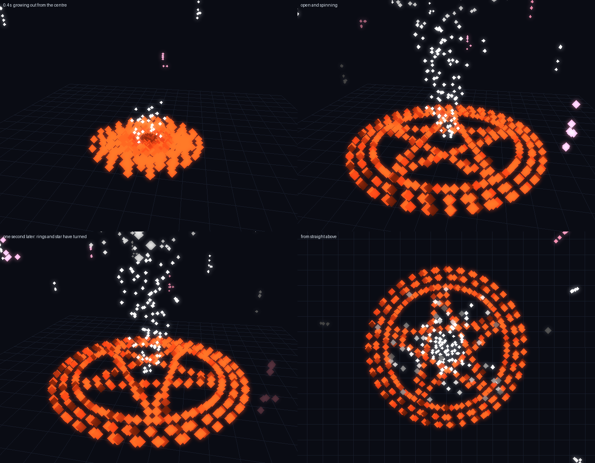

# DH (spinning circle, particles only)

A red circle on the floor with a five-pointed star inside
it, made of particles only. No meshes are used. Rebuilt from your
screenshot. Sim-tested only; it has not been run in Bloxd.



The picture is drawn by `tools/render.py` from the test run. It is not a
screenshot of the game; real particles will look softer.

## Use it

- **World Code:** paste `world_code.js` (about 7,200 characters) and type
  `!dh`. It opens under your feet. `!dh` again closes it. If other
  world code is there too, paste this **after** it.
- **Code Block, no World Code needed:** paste `code_block.js` (7,901 of
  32,000 characters) and click the block. The circle appears on top of the
  block, centred on it, turns for 6 seconds and is gone. Click again to
  start it again.

Why the two versions differ: in the game, a `tick` set from a code block is
not run (tested by you: the circle stood still). So a code block gets to run
only at the moment of the click and cannot keep re-drawing the circle.
Instead, the click throws every particle sideways and gives it a pull toward
the centre, so the particles carry the turn themselves:

- the star and inner ring turn about 63 degrees in the 6 seconds, the two
  outer rings the same amount the other way;
- as a side effect the whole circle grows about 12% by the end (under 1% in
  the first 3 seconds);
- no falling strings, and the sparks are one burst.

**For a circle that spins without end, use World Code.** That is the only
place the game runs code every tick.

Not confirmed from here: that the game applies the sideways speed and the
pull exactly as the particle options say. If the block's circle drifts apart
instead of turning, tell me what it does.

From other code: `dh(playerId)` or `dh(playerId, [x, y, z])`. In the code
block version the function is called `spinCircleOnce`, because a two-letter name
could be caught by the word filter.

## What it is

| Part | Particles | Moves |
|---|---|---|
| Two outer rings | 70 and 64 points, at 5 and 4.5 blocks from the centre | Turn one way |
| Inner ring | 56 points at 3.9 blocks | Turns the other way |
| Star | 80 points, 16 on each of its 5 lines, tips on the inner ring | Turns with the inner ring |
| Sparks | White, 3 every tick | Rise from the centre and slow down |
| Falling strings | Short strings of small white and pink squares, 6 to 9 blocks out and 3 to 9 up | Drift down and fade |

The pattern is 270 points with 2 particles on each, set within 0.09 blocks
of the point so the lines look thick and solid. It is 10 blocks across and
lies flat on the floor. It makes no sound. Every floor
particle is one solid red (`RITE_COL.red`, 255, 62, 18) for its whole life:
no lighter start, no darker end and no fading. It
grows out from the centre in 1.2 seconds, then turns at 0.5 radians a second
(a full turn every 12.6 seconds).

Particles fade, so the points are re-lit all the time: 45 each tick, so each
point comes round again every 6 ticks, at its new turned position. That is
at most 48 particle calls a tick (up to about 800 floor particles alive at once). If the game drops particles at that rate,
lower `pointsPerTick` (each point then lives longer and the turning looks
more stepped).

## Settings (`RITE_CFG`)

| Name | Meaning |
|---|---|
| `chat` | Chat command (`!dh`) |
| `size` | Scale (1 = 10 blocks across) |
| `spin` | Turning speed in radians a second (0.5). 0 = still |
| `pointsPerTick` | Points re-lit each tick (45) |
| `perPoint` | Particles on each point (2). 1 = thinner lines, 3 = denser, at no change in calls |
| `thick` | How far those particles may sit from the point, in blocks (0.09) |
| `sparks`, `glyphs` | The rising sparks and the falling strings; false = off |
| `growTicks` | Ticks to grow to full size (24) |
| `duration` | Seconds until it closes by itself; 0 = stays until toggled off |
| `onceTime` | Code block: seconds one click lasts (6) |
| `onceTurn` | Code block: how far it turns in that time (1 = about 63 degrees, with 12% growth; 0.7 = about 43 degrees, 3% growth) |
| `hideDist` | Visible up to 120 blocks |
| `maxCircles` | How many can be open at once (2) |

Colours are in `RITE_COL`, ring sizes and directions in `RITE_RINGS`
(`[radius, points, direction]`), the star in `RITE_STAR`.

The code uses long names throughout so the code-block word filter has
nothing to star out (see the Hologram README); `tools/check.mjs` tests this.

## Check it

```
node tools/check.mjs --dump /tmp/rite.json
python tools/render.py /tmp/rite.json preview/circle.png
```

`code_block.js` is generated from `world_code.js` by `tools/check.mjs`; do not
edit it by hand.
