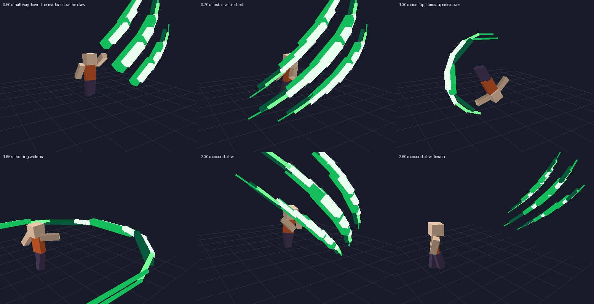

# Dragon Claw

A close-range move: the player claws, turns a full 360, and claws again.
Sim-tested only; it has not been run in Bloxd.



The picture is drawn by `tools/render.py` with the player posed the way the
animation editor poses it. It is not a screenshot of the game.

## Use it

Paste `world_code.js` into World Code. If Dragon Pulse or other world code is
there too, paste this **after** it: it keeps the earlier `tick`, chat and
right-click handlers working. Then type `!claw`.

From other code: `dragonClaw(playerId)`.

## What happens (3.05 s)

| Seconds | Player animation | Meshes and particles | Hit |
|---|---|---|---|
| 0.00–0.40 | Wind-up: right arm goes up and back | Claws appear on both hands (node meshes) | |
| 0.40–0.70 | The slash: the arm comes down across the body, starting slowly and speeding up | Three slash marks, 4.8 blocks tall, grow from top to bottom together with the arm, a bit more every tick, with sparks at the tips | From half way down: what stands right in front |
| 0.70–0.90 | Follow-through | The marks hang with a flash | |
| 0.75–1.30 | Arms go out (from 0.90) | The marks shoot forward, fast at first and slowing down, as far as `range` (10 blocks) | Everything they pass, once |
| 1.05–1.65 | Side flip: the player is pushed up and rolls over sideways, a full turn in four quarter steps, arms out; the legs go round with the body | An upright loop is drawn round the player, piece by piece, as they roll | |
| 1.65–2.00 | Second wind-up: left arm goes up and back | On landing the loop drops flat and widens out to `spinRange` (6 blocks); a ring of 18 particles flies outward | Everything the ring reaches, once |
| 2.00–2.30 | The second slash, the other way | Three more marks grow with the arm, crossing the first | From half way down |
| 2.30–2.90 | Follow-through, then back to rest at 2.75 | These hang and fly forward too | Everything they pass, once |
| 2.75–2.90 | Pose is reset | Claws are taken off | |

At most 53 mesh entities at once and 92 api calls in one tick.

The timing is in two tables (20 ticks a second). `CLAW_POSE`: the first number
of each row is the tick that pose is reached. `CLAW_STEP`: when the marks and
the ring start and end, plus `draw` (ticks a slash takes to be drawn, 6),
`fly` (ticks it flies, 10) and `turn` (ticks of the spin, 12). Keep `draw`
equal to the length of the arm's downswing in `CLAW_POSE`.

## Range

`range` is how far the claw marks fly (10) and `spinRange` how far the ring
widens (6). `CLAW_MAX_RANGE` is 15: whatever the two are set to, nothing
further than 15 blocks is reached or hit. A claw mark hits what is within 2.8
blocks to either side of its path (it grows with `slashSize`).

## The animation

The poses are in `CLAW_POSE` in `world_code.js`: one row per keyframe, with the
time in ticks (20 a second) and, per body part, its turn in degrees `[x, y, z]`,
the same numbers the animation editor shows. A third value on a row is how far
the whole body has turned (the spin).

The game gets it as 14 small `api.animateEntity` calls, one from each pose to
the next, of 600 to 750 characters each. The first version sent three calls of
up to 2,600 characters and the game refused them ("argument is too large").
Only rotations are sent, rounded to two decimals.

If the game refuses an animation call, the move goes on without the animation
and the reason is shown to the caster in chat.

To look at it or change it in the editor
(https://tridentify.github.io/animation-editor/):

- `animation/Dragon Claw.bloxdmation`: open it with the editor's file import.
- `animation/animation_only.code_block.js`: the same animation as
  `api.animateEntity` code, for the editor's "import code". It is not meant
  to be run in the game by itself.

Both files are written by `node tools/check.mjs` from `CLAW_POSE`, so they
always match the world code. Changes made in the editor do not come back by
themselves: send the changed file and the numbers can be carried over.

## Settings (`CLAW_CFG`)

| Setting | Meaning |
|---|---|
| `chat` | Chat command, `""` for none |
| `item` | Name of a held item that casts it on right click, `""` for none |
| `range` | Blocks the claw marks fly forward (15 at most) |
| `spinRange` | Blocks the ring of the spin widens to (15 at most) |
| `slashSize` | Size of the claw slashes (1.6; 1 is the old size, 0.5 to 3). The lane they hit is 1.2 + this wide to either side |
| `spin` | `"side"` = side flip between the two claws; `"turn"` = the flat 360 turn on the spot with a flat ring |
| `hop` | Upward push at the start of the side flip (7; 0 = stay on the ground) |
| `damage`, `spinDamage` | Damage of each claw and of the spin |
| `knockback` | Push on everything that is hit |
| `lunge` | Push forward on the player at each claw, 0 for none |
| `hitPlayers` | Whether other players are hit, or only mobs |
| `animate` | Whether the player is animated |
| `flip` | 1 or -1: which way the arms and body lean. Set -1 if the arms swing backward in the game |
| `nodeClaws` | Whether claws are attached to the hands |
| `sounds`, `hideDist`, `maxCasts`, `maxMeshes` | As in Dragon Pulse |

Colours are in `CLAW_COL` (white, core, edge, deep), sounds in `CLAW_SND`,
timings in ticks in `CLAW_STEP`.

## Meshes (`CLAW_MESH`)

| Group | Rows | What |
|---|---|---|
| `talon` | 9 | The bright core of one slash mark from end to end: place along it (-1 to 1), thickness, colour |
| `glow` | 5 | The wider, darker edge behind that core |
| `mark` | 3 | The three marks of one claw: sideways offset, length, thickness. One claw is 3 × (9 + 5) = 42 meshes |
| `ring` | 16 | The ring of the spin: thickness, colour. Every second piece gets a darker piece behind it (24 meshes) |
| `hand` | 7 | Node meshes on each arm: three talons of two pieces each (the tip bent forward), then a wide blade |

The blade is attached last on purpose. The documentation only shows one node
mesh per body part; if the game keeps only the last one, the blade is what
shows, and if it keeps all of them, the talons show as well.

## Not known until it runs in the game

- Which way `api.animateEntity` turns each part. The poses follow the editor's
  preview. If the arms swing backward, set `flip: -1`.
- Whether the legs follow the torso by themselves (then they would turn twice in
  the spin).
- Which side the game puts the right arm on; the first slash mark is drawn on
  the side the editor's model has it.
- Whether a body part can carry more than one node mesh (see above).
- Taking the claws off clears both arm nodes, so an arm piece of a node-mesh
  skin (`!skin`) is removed too.

## Check it

```
cd dragon_claw
node tools/check.mjs --dump /tmp/claw.json
python tools/render.py /tmp/claw.json preview/moments.png
```
