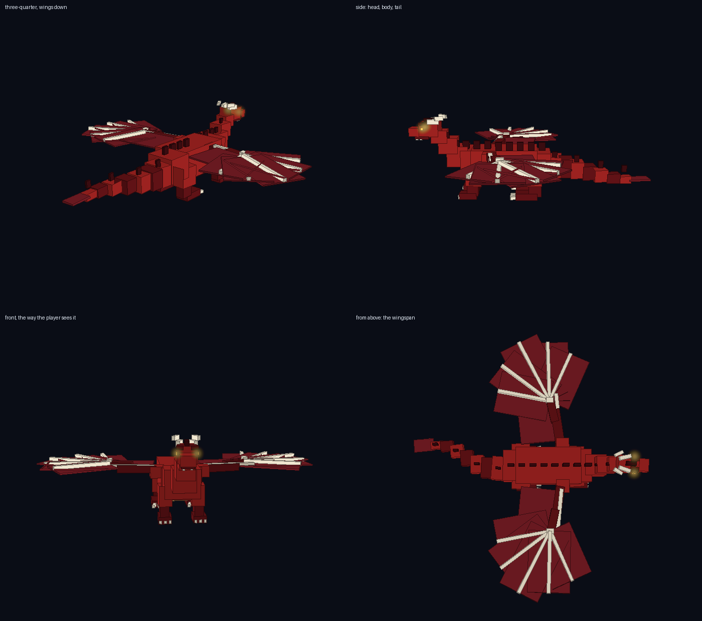

# Dragon Model

A dragon built out of 105 boxes, about 3 blocks tall with a 7-block wingspan. It stands in front of the player facing them, and it breathes while it stands there: the wings flap, the tail sways and the head turns slowly.



The picture is my own render of the test run (four angles of the same pose), not a Bloxd screenshot. **The model has not been seen inside Bloxd yet**, so the colours and the way the boxes meet are still guesses.

For the navy and red skeleton from the reference picture (Eternatus, Eternabeam), see [eternabeam](../eternabeam/README.md).

## Two ways to use it

1. **World Code** (`world_code.js`, 7k characters): paste it in, then type `!dragon` in chat. The dragon builds itself in front of you over about 0.9 s (six boxes a tick, so it grows rather than pops), then stands there moving. Type `!dragon` again and it is taken away. Each player gets their own, up to 4 at once, and `dragonShow(playerId)` does the same from your own code.
2. **A code block** (`code_block.js`, 4.7k characters): paste it into a code block and click the block. The whole dragon appears at once in front of the player who clicked, and clicking again removes it. This one stands still, because a code block cannot keep running.

Both files carry their own copy of the model, so if you change a box, change it in both.

## What it is made of

- **Body:** three stacked boxes (chest, middle, hips) with five amber belly plates underneath.
- **Legs, 4:** thigh, shin, foot and three bone claws each. It stands on the ground, nothing sinks into the floor.
- **Neck and head:** three neck boxes stepping up and forward, then skull, snout, jaw, two brows, two glowing amber eyes, two swept horns, a crest and small teeth.
- **Wings, 32 boxes each pair:** shoulder, upper arm, forearm, a big inner panel, then a fan of five flat panels with a bone spar along each, radiating from the wrist, plus a claw at the wrist.
- **Tail:** seven boxes tapering away, with spike plates on top and a fin at the tip.
- **Spine:** eight spike plates along the back and two on the neck.

Colours are in `dragonCol`: deep red body, darker red legs and arms, amber belly, lighter red wing membranes, bone horns and claws, glowing amber eyes.

## Settings

There are none. To change the look, edit the numbers in `dragonPlan`: each line is `add(x, y, z, wide, tall, deep, yaw, colour, tag, reach)` in blocks, where `tag` decides what moves (`wing`, `tail`, `head`) and `reach` is how far a wing box is from the shoulder, which sets how far it flaps.

To make it bigger or smaller, change every number in one go is not possible; instead the whole model can be scaled by editing `dragonBox` to multiply the sizes, and the positions the same way.

## Test

```
node tools/check.mjs
```

It stands the model up in a stand-in game and checks 105 boxes, the left-right symmetry, that it faces the player, that nothing sinks into the floor, that the wings, tail and head actually move, that two players can each have one (200 boxes, still under the 400 limit), that it never tilts a box (only turning left and right), that it says nothing in chat, and that a second `!dragon` removes every box again. The code block is run the same way: one click builds 105 boxes, a second click removes them. `--dump frames.json` writes a picture dump for `tools/render.py`.

## Not sure until it is tried in Bloxd

- Whether the colours read well in game; every box is fully lit by its own colour, so red may look flat.
- Where the wings sit relative to the real player scale, and whether the flap range looks right.
- Whether the build-up looks good or too slow: it is six boxes a tick, about 0.9 s in all.
- Whether the game plays 105 mesh boxes without trouble (the limit I aimed under is 400 at once, and about 120 creations a second; this builds six a tick, right at that guide).
