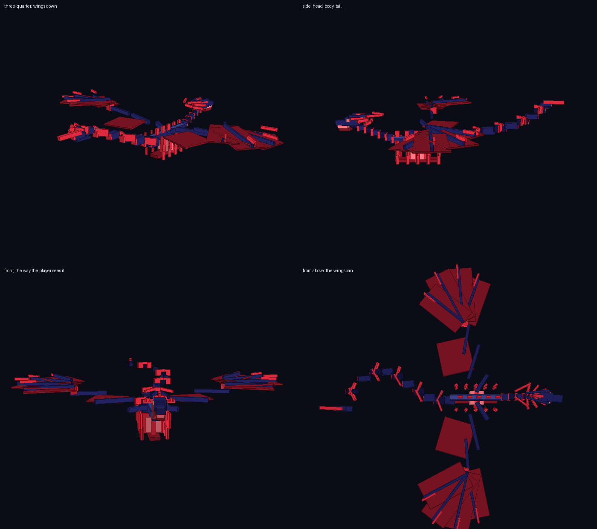

# Eternabeam

The dragon from your picture — Eternatus — as 128 boxes: dark indigo skeleton, red ribs and spikes, a hot pink core glowing inside the ribcage. No legs: it floats. About 3.7 blocks tall, 10.7 blocks from snout to tail tip, and it moves while it hangs there — the wings beat, the tail whips up and down, the head turns slowly.



The picture is my own render of the test run, four angles of one pose, not a Bloxd screenshot. **It has not been seen inside Bloxd yet.**

A plain red dragon in the same style is in [dragon_model](../dragon_model/README.md).

## Two ways to use it

1. **World Code** (`world_code.js`, 9k characters): paste it in, then type `!eternabeam`. It builds itself in front of you over about 1.1 s, six boxes a tick, then hangs there moving. `!eternabeam` again takes it away. Each player gets their own, up to 4 at once. `eternaShow(playerId)` does the same from your own code.
2. **A code block** (`code_block.js`, 7k characters): paste it into a code block and click the block. The whole thing appears at once in front of the player who clicked; click again to remove it. It stands still, because a code block cannot keep running.

Both files carry their own copy of the model, so a change has to be made in both.

## What it is made of

- **Ribcage, no legs:** a navy spine bar with a lighter ridge, a hot pink core box inside a red frame, a dark red belly, five pairs of angled red ribs, and six red spikes along the spine.
- **Neck:** six boxes stepping up and forward, each joint a red band, ending in the head.
- **Head:** navy skull and snout, a glowing mouth, dark red lower jaw, two glowing eyes, three red frill spikes swept back each side, a long navy horn and a shorter red horn each side, and a red crest.
- **Wings, 34 boxes:** shoulder, two arm bones out to the wrist, a dark red inner membrane, then a fan of four panels from the wrist — dark red webbing with a navy bone along each — each ending in a red tip spike, plus a red claw at the wrist.
- **Tail:** eleven boxes curving up and back, a red band at every joint, red spikes out both sides of every other segment, and a red blade at the tip.

Colours are in `eternaCol`: two indigo blues, a lighter blue for the spine ridge, two reds, and a hot pink glow for the core, the mouth and the eyes.

## The one limit that shaped it

Bloxd meshes cannot be tilted, only turned left or right. So the ribcage ribs, the wing fan and the tail spikes are all built from thin boxes turned in the flat plane. From the side and from above it reads as a skeleton; it will never be as needle-thin as the drawing.

## Settings

There are none. The model is one line per box:

```
add(x, y, z, wide, tall, deep, yaw, colour, tag, reach)
```

in blocks. `tag` decides what moves (`wing`, `tail`, `head`) and `reach` is how far a wing box is from the shoulder, which sets how far it beats. Nothing goes below y = 1.1, so it floats above the ground.

## Test

```
node tools/check.mjs
```

It stands the model up in a stand-in game and checks 128 boxes, left-right symmetry, that it faces the player, that no box touches the floor, that the wings, tail and head really move, that it never tilts a box, that it is silent, that a second `!eternabeam` removes every box, that two players can each have one (256 boxes, under the 400 limit), and that the code block builds and removes the same model. `--dump frames.json` writes a picture dump for `tools/render.py`.

## Not sure until it is tried in Bloxd

- Whether the hot pink core reads as a glow: meshes cannot glow, that is just a bright colour.
- Whether the ribcage looks like a cage and not a solid box from normal player distance.
- Whether the wings look right raised in the fan pose; they are one flat layer, so they are wide from above and thin from the side.
