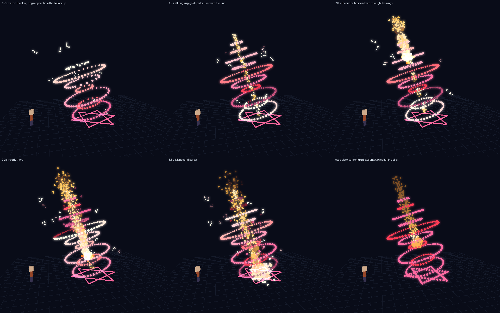

# FR

A slanted stack of ten pink rings over a six-pointed star, a line of gold
sparks down the middle, and a fireball that drops through every ring and
bursts on the floor. Rebuilt from your screenshot with few meshes (12) and
many particles. Sim-tested only; it has not been run in Bloxd.



The picture is drawn by `tools/render.py` from the test run, with a
player-sized figure for scale. It is not a screenshot of the game.

## Use it

- **World Code (the full move):** paste `world_code.js` (about 14,900
  characters) and type `!fr`. It lands 8 blocks in front of you. If other
  world code is there too, paste this **after** it.
- **Code Block, no World Code needed:** paste `code_block.js` (14,619 of
  32,000 characters) and click the block. The show plays on top of the
  block. See below for what is different.

From other code: `fr(playerId)`, `fr(playerId, [x, y, z])` or
`fr(playerId, [x, y, z], [fx, fz])` to choose which way it leans. Inside the
code block the names are `frCast` and `frOnce`, and the chat command is left
out, because a bare two-letter word could be caught by the word filter.

## World Code version (3.9 seconds)

| When | What |
|---|---|
| 0 s | The star is drawn on the floor: 6 thin mesh bars, two crossed triangles, 6.2 blocks across |
| 0 to 1.1 s | The ten rings snap in one after another from the bottom up. They are particles: 335 points, kept lit by re-lighting 19 a tick |
| 1.1 s on | Gold sparks run down the middle line; small white squares drift down around it |
| 2.1 s | The fireball appears 13 blocks up the line: 6 mesh boxes (two crossed cubes and four glowing bars) that spin |
| 2.1 to 3.4 s | It drops down the middle, speeding up, leaving a thick gold trail (23 particles a tick). Each ring throws off a burst as the fireball goes through it |
| 3.4 s | It lands: 200 particles burst out with a shock ring along the floor. 40 damage and knockback to everything within 4 blocks, except the caster |
| 3.9 s | The star is deleted. No mesh is left |

The rings are 0.7 to 3.4 blocks in radius, all square to one line that
leans 18 degrees back toward the caster, 12 blocks long.

Meshes: 12 at most (the limit you set is 400). Every mesh is level, only
turned left or right; the slanted rings are particles, so nothing depends on
which way the game tilts a mesh. At most 49 particle calls in a tick.

## Code block version

A code block runs only at the moment of the click (the game does not run
`tick` for it), so it cannot move a mesh, delete one later, or deal damage
at the right moment. So this version is particles only and is a show, not an
attack:

- rings and star: all emitted on the click, lasting 4.5 seconds;
- fireball: a clump of 30 big particles thrown down the line at a steady
  speed, reaching the floor after about 4 seconds;
- trail: 26 puffs wait unseen along the line, and each turns visible when
  the fireball reaches it;
- landing: a flash that waits unseen on the floor and shows when the
  fireball arrives. It does not burst outward;
- no damage, no drifting squares.

It makes 448 particle calls on the click. The unseen-then-visible trick
relies on the game following the colour steps of a particle exactly; if the
trail or flash show from the start, tell me.

## Settings (`FR_CFG`)

| Name | Meaning |
|---|---|
| `chat` | Chat command (`!fr`) |
| `distance` | Blocks in front of the caster where it lands (8, never more than 15) |
| `size` | Scale |
| `tilt` | Lean of the line in degrees (18). 0 = straight up |
| `damage`, `radius`, `knockback`, `hitPlayers` | 40 damage within 4 blocks, push 10, players are hit too |
| `ringTicks` | Ticks between re-lighting the same ring point (18). Lower = brighter rings, more calls |
| `buildTicks`, `waitTicks`, `flyTicks` | Ticks for the rings to appear (22), the pause (20), the fall (26) |
| `onceTime` | Code block: seconds the show lasts (4.5) |
| `hideDist` | Visible up to 150 blocks |
| `maxCasts`, `maxMeshes` | 2 casts at once, 60 meshes |

Rings are in `FR_RINGS` as `[distance up the line, radius, colour]`,
colours in `FR_COL`, the fireball boxes in `FR_BALL`. There are no
sounds.

## Check it

```
node tools/check.mjs --dump /tmp/fr.json
python tools/render.py /tmp/fr.json preview/fr.png
```

`code_block.js` is generated from `world_code.js` by `tools/check.mjs`; do not
edit it by hand.
