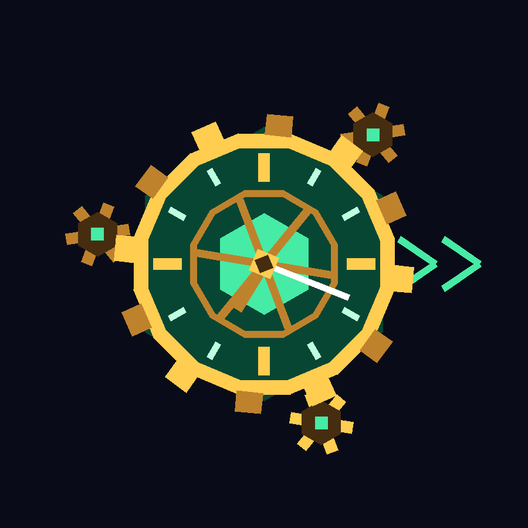

# Gear Portal (Move 1)

Use the move and an arrow appears at once, showing where you will land. Use it again (or click) and it goes off: a steampunk gear portal opens under you, you drop in, come out of a second portal where the arrow pointed, and do a 360 slash straight away.


The portal seen from above:



The picture is my own render of the test run, not a Bloxd screenshot. **The move has not been run inside Bloxd yet.**

## How to use it

1. Paste `world_code.js` (22k characters) into World Code.
2. Type `!portal` in chat: the arrow appears. Turn to aim. Then click, or type `!portal` again, to do the move. (`gearPortal(playerId)` from your own code does the same: first call aims, second call goes.)
3. Optional: paste `code_block.js` into a code block. Clicking the block casts the move for the player who clicked. It needs the World Code, because a code block runs only once per click and this move has to run for several seconds.

## What happens

| Step | What you see |
|---|---|
| Aim (up to 3 s) | Three arrow heads on the floor in front of the player, there from the first tick, following where the player looks. Sparks mark the landing spot 6 blocks away. The caster also sees the game's own arrow strip. The player is visible and can walk; the arrow goes with them. |
| Go | On a click, a second `!portal`, or by itself after 3 seconds. The landing spot is fixed at this moment. |
| 0 – 0.3 s | The first portal opens under the player's feet. The player crouches, leaps with arms up, and corkscrews down, shrinking and fading. |
| 0.3 s | The player lands where the arrow pointed. The second portal opens there and the first one folds away. |
| 0.35 – 1.25 s | The player winds up and turns a full 360 with the blade arm out while a green band sweeps once round. Everything within 3 blocks takes 25 damage and is knocked away. The player ends in a lunge, holds it, and stands up while the second portal folds away. |

Set `aimTime` to 0 for no aiming step: one use, and the move goes off straight ahead.

A wall in the way shortens the teleport.

## Parts

- **Two portals, 86 meshes each:** a clock face inside a big gear. Dark green face with a bright centre, 12 hour marks (the four main ones bigger and gold), a short hour hand and a long white minute hand that sweeps a full turn each second, a spoked wheel turning the other way, a gold rim with 12 gear teeth that turn slowly, and three small gears on the outside turning against each other. 28 of the 86 pieces move.
- **Slash, 36 meshes:** 18 green pieces with a bright edge, shown for 0.2 s each.
- **Arrow, 6 meshes**, plus the game's own arrow strip on the ground (only the caster sees that one).
- **Node meshes, 3:** a green blade on the right arm, a brass block on the left arm, a gear plate on the back. They are on while dropping in and during the slash.
- **Particles:** green sparks rising from the portal, gold glints, grey steam puffs, a stream pulled down into the first portal, bursts on entering and leaving, sparks along the slash.
- **Player animation, 16 small `animateEntity` calls:** ready pose with the blade arm pointing ahead while aiming; crouch, leap with arms up, half-turn corkscrew down while the player shrinks into the portal; coming out the player grows back, winds up, turns a full 360 leaning into the turn with the blade arm out, ends in a lunge that is held for 0.2 s, then stands up.

At most 167 meshes exist at once.

## Settings (`GATE_CFG` at the top)

| Name | Default | Meaning |
|---|---|---|
| `travel` | 6 | blocks teleported from the first portal to the second (15 at most) |
| `aimTime` | 3 | seconds the arrow is shown before the move goes off by itself; 0 = no aiming |
| `slashRadius` | 3 | reach of the slash |
| `damage`, `knockback` | 25, 8 | what the slash does |
| `hitPlayers` | true | false = only mobs are hit |
| `clickFires` | true | a click while aiming does the move |
| `shrink` | true | the player shrinks while going down and grows back coming out (uses `setLifeformScale`) |
| `hidePlayer`, `holdPlayer` | true | invisible / held in place and safe for the moment inside the portal |
| `animate`, `nodeMeshes`, `groundArrow`, `sounds` | true | switch a part off |
| `flip` | 1 | set to -1 if the player bends backwards instead of forwards |

## Not sure until it is tried in Bloxd

- Whether the poses bend the right way (`flip` fixes forward/backward) and whether the 360 turn looks smooth.
- Whether `shrink` behaves: it changes the player's real size for a moment. If the player gets stuck or stays small, set `shrink` to false.
- Where the three node meshes sit on the body.
- The name tag probably stays visible while the player is hidden.
- Whether the four sound names exist; a wrong name is skipped silently.
- Particle sizes and brightness.

## Test

```
node tools/check.mjs --dump frames.json
python tools/render.py frames.json preview/portal.png
```
