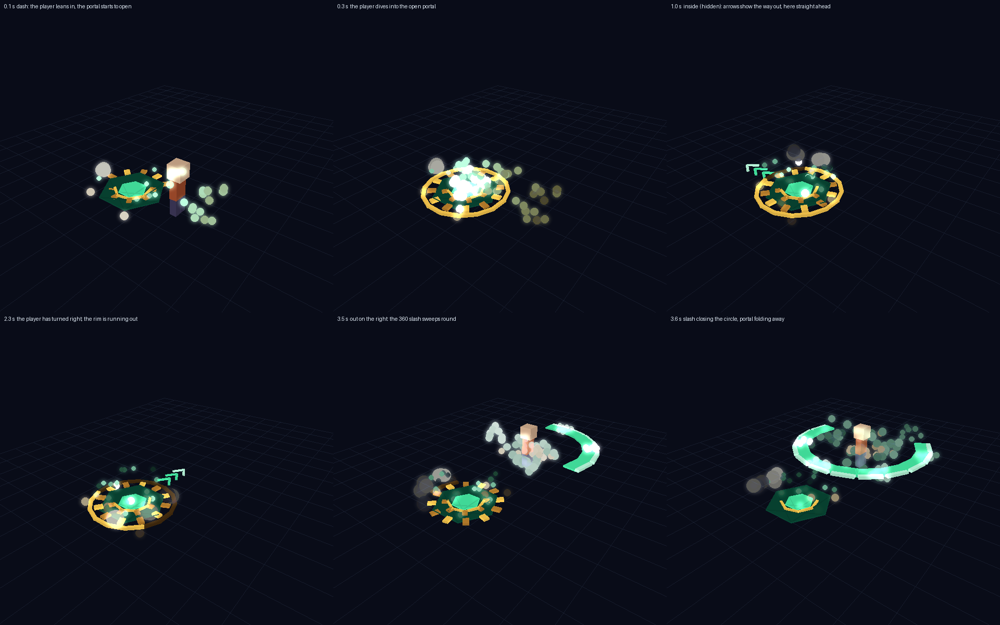

# Gear Portal (Move 1)

The player dashes into a steampunk gear portal on the floor, hides inside for up to 3 seconds, picks a direction, comes out there and does a 360 slash.



The picture is my own render of the test run, not a Bloxd screenshot. **The move has not been run inside Bloxd yet.**

## How to use it

1. Paste `world_code.js` (19.7k characters) into World Code.
2. Type `!portal` in chat, or call `gearPortal(playerId)` from your own code.
3. Optional: paste `code_block.js` into a code block. Clicking the block casts the move for the player who clicked. It needs the World Code, because a code block runs only once per click and this move has to run for several seconds.

## What happens

| Time | What you see |
|---|---|
| 0 – 0.3 s | The player is carried 4 blocks forward, leaning in and then diving head first. The portal opens at the landing spot. |
| 0.3 – 3.3 s | The player is invisible and held in the middle of the portal, and cannot be hurt. Arrow heads on the floor point where the player is looking. The gold rim goes dark piece by piece as a timer. |
| leaving | After 3 seconds, or earlier on a click or a second `!portal`, the player appears 4 blocks from the portal in the direction they are looking. |
| + 0.4 s | The body turns a full 360 with arms out while a green band sweeps once round. Everything within 3 blocks takes 25 damage and is knocked away. The portal folds away. |

A wall in the way shortens the dash or the exit.

## Parts

- **Portal, 50 meshes:** dark green disc, bright centre, gold rim, outer cog ring turning one way, inner cog turning the other way.
- **Slash, 36 meshes:** 18 green pieces with a bright edge, shown for 0.2 s each.
- **Arrow, 6 meshes**, plus the game's own arrow strip on the ground (only the caster sees that one).
- **Node meshes, 3:** a green blade on the right arm, a brass block on the left arm, a gear plate on the back. They are on during the dash and the slash.
- **Particles:** green sparks rising from the portal, gold glints, grey steam puffs, a dash trail, bursts on entering and leaving, sparks along the slash.
- **Player animation:** 8 small `animateEntity` calls (lean, dive, four quarter turns, settle, stop).

At most 56 meshes exist at once.

## Settings (`GATE_CFG` at the top)

| Name | Default | Meaning |
|---|---|---|
| `dash` | 4 | blocks dashed into the portal (15 at most) |
| `stay` | 3 | seconds the player may stay inside |
| `leave` | 4 | blocks from the portal to the exit spot |
| `slashRadius` | 3 | reach of the slash |
| `damage`, `knockback` | 25, 8 | what the slash does |
| `hitPlayers` | true | false = only mobs are hit |
| `clickLeaves` | true | a click while inside leaves early |
| `hidePlayer`, `holdPlayer` | true | invisible / cannot walk, jump or be hurt while inside |
| `animate`, `nodeMeshes`, `groundArrow`, `sounds` | true | switch a part off |
| `flip` | 1 | set to -1 if the player bends backwards instead of forwards |

## Not sure until it is tried in Bloxd

- Whether the lean and dive bend the right way (`flip` fixes it) and whether the 360 turn looks smooth.
- Where the three node meshes sit on the body.
- The name tag probably stays visible while the player is hidden.
- Whether the four sound names exist; a wrong name is skipped silently.
- Particle sizes and brightness.

## Test

```
node tools/check.mjs --dump frames.json
python tools/render.py frames.json preview/portal.png
```
