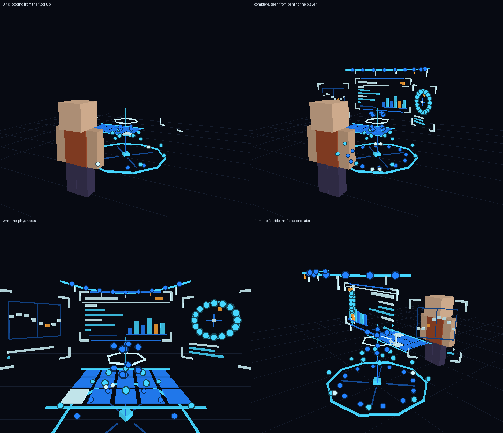

# Hologram

A player-sized holographic computer made of meshes, in the style of the
floating screens in the Iron Man films: three screens, an arc overhead, a
key board, a turning wire globe and a projector ring on the floor.
Sim-tested only; it has not been run in Bloxd.



The picture is drawn by `tools/render.py` from the test run, with a
player-sized figure for scale. Round dots are particles. It is not a screenshot of the game.

## Use it

Either way works on its own.

- **World Code:** paste `world_code.js` (about 19,300 characters) and type
  `!holo`. It opens 2 blocks in front of you, facing you. `!holo` again
  closes it. If other world code is there too, paste this **after** it.
- **Code Block, no World Code needed:** paste `code_block.js` (19,328 of
  32,000 characters) into a Code Block and click it. The whole hologram
  appears at once on top of the block, facing whoever clicked. Click again
  to remove it. There is no chat command in this version.

About the code block: a click creates all 120 meshes in the same instant, so
it does not depend on anything else running. Two things follow from that:

- 120 is right at the cap of about 120 created per second that you
  mentioned. If parts are missing at the top, use the World Code version,
  which builds 5 a tick.
- The moving parts need the game to call a `tick` that a code block
  assigned, which is not documented. If it does, the hologram moves; if not,
  it is a still picture.

Code blocks go through the game's word filter, which replaces anything it
reads as a bad word with `**` and so breaks the code. It reads each run of
characters between spaces with the punctuation taken out, so `s.x` counted
as the word "sx". To stay clear of it, the code uses no 1 or 2 letter names
(`state.posX` instead of `s.x`), and `tools/check.mjs` fails if any piece of
the code block reads as a word on its filter list. The game's real list is
not known, so that list is a guess.

From other code: `hologram(playerId)`, `hologram(playerId, [x, y, z])`, or
`hologram(playerId, [x, y, z], [fx, fz])` to choose the direction it faces.

## What it is made of (120 meshes + 61 particle points)

| Part | Meshes | Particle points | Moves |
|---|---|---|---|
| Floor projector | 16: outer ring, 4 spokes, emitter block, light line up the middle | 28: inner ring, 8 raised points round the rim, small ring under the globe, 2 markers | The 2 markers run round the ring |
| Globe | 7: one hoop and a pole | 8: the upper and lower hoops | Turns |
| Main screen | 27: corner brackets, title bar, orange status block, 6 text lines, 6-bar chart, scan line | | Text types out, holds and clears; bars rise and fall; the scan line sweeps |
| Gauge screen | 19: brackets, crosshair, 3 text lines, orange needle dot | 16: the round dial | The needle dot goes round the dial; text types |
| Graph screen | 23: brackets, grid, a graph of 8 dots, 2 text lines | | The graph ripples; text types |
| Arc overhead | 11: curved line with 5 hanging tick marks | 9: the inner line | |
| Key board | 17: 15 flat keys in 3 rows between two rails | | Keys light up two at a time |

It is 2.5 blocks tall and 3.3 wide. It boots from the floor up in 1.2
seconds, 5 meshes a tick (100 a second), and closes 30 a tick.

Particles do not stay, so the points are re-lit all the time: 5 of the 51
still points each tick (each lasts just over half a second, until its turn
comes round again) and the 10 moving ones every third tick. That is at most
15 particle calls a tick. This needs `tick` to run. In a code block where
the game does not run `tick`, the points are lit once on the click and fade
after 3 to 4 seconds, leaving the 120 meshes.

Once it is up it costs at most 43 api calls a tick. With `animate: false`
and `particles: false` it costs none.

Every mesh is level, only turned left or right, never tilted. So it does not
depend on which way the game tilts meshes, which was the suspected cause of
the Dragon Claw slashes merging. The round gauge dial, which would need slanted
lines, is made of particle points instead.

Meshes cannot be see-through in Bloxd, so the "hologram" look comes from thin
glowing lines and empty space, not from transparency.

## Settings (`HOLO_CFG`)

| Name | Meaning |
|---|---|
| `chat` | Chat command (`!holo`) |
| `distance` | Blocks in front of the player where it opens (2) |
| `size` | Scale (1 = player sized) |
| `spawnPerTick` | Meshes created per tick while booting (5) |
| `particles` | false = meshes only |
| `dotsPerTick` | How many still particle points are re-lit each tick (5) |
| `animate` | false = build it and leave it still |
| `sounds`, `hideDist` | Sounds on; visible up to 60 blocks |
| `maxHolos` | How many can be open at once (1) |
| `maxMeshes` | 399 |

Colours are in `HOLO_COL` (`bright`, `cyan`, `blue`, `dim`, and `warn` for
the orange accents). Screen positions and sizes are in `HOLO_PANEL`.

## Check it

```
node tools/check.mjs --dump /tmp/holo.json
python tools/render.py /tmp/holo.json preview/hologram.png
```

`code_block.js` is generated from `world_code.js` by `tools/check.mjs`; do not
edit it by hand.
