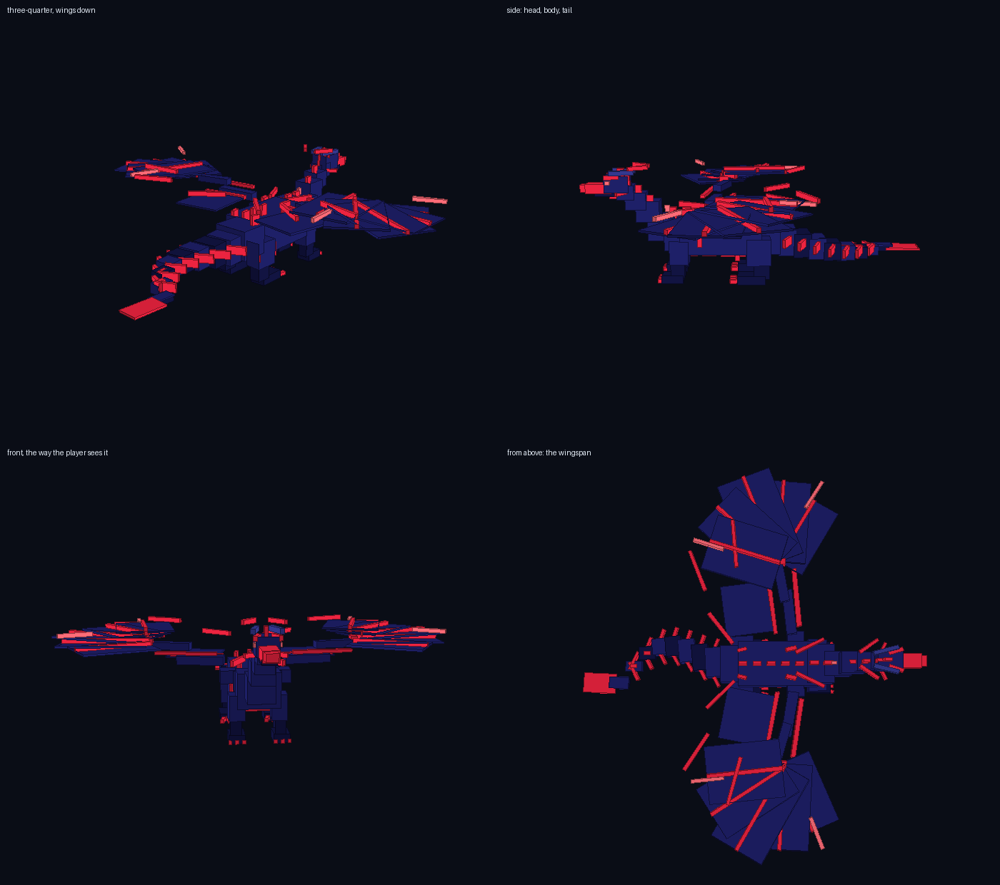

# Night Dragon

The dragon from your picture, built out of 155 boxes: deep navy body, red shard spikes and stripes all over it, glowing pink eyes and claws. About 3.4 blocks tall, 9.5 blocks from snout to tail tip, and it moves while it stands there — the wings beat, the tail whips, the head turns.



The picture is my own render of the test run, four angles of one pose, not a Bloxd screenshot. **It has not been seen inside Bloxd yet.**

A plain red dragon, calmer and smaller, is in [dragon_model](../dragon_model/README.md).

## Two ways to use it

1. **World Code** (`world_code.js`, 9k characters): paste it in, then type `!night`. It builds itself in front of you over about 1.3 s, six boxes a tick, then stands there moving. `!night` again takes it away. Each player gets their own, up to 4 at once. `nightShow(playerId)` does the same from your own code.
2. **A code block** (`code_block.js`, 7k characters): paste it into a code block and click the block. The whole dragon appears at once in front of the player who clicked; click again to remove it. It stands still, because a code block cannot keep running.

Both files carry their own copy of the model, so a change has to be made in both.

## What it is made of, and what the picture turned into

- **Navy body:** three boxes (chest, middle, hips) with red belly plates and red rib strips down both flanks.
- **Head:** navy skull, long red snout and nose, dark jaw, red brow spikes, a crest spike, a chin spike, two swept horns with red tips, cheek spikes, and two hot pink eyes.
- **Neck:** four boxes stepping up, with three red spikes along the top.
- **Wings, 46 boxes:** shoulder, two arm boxes, a big inner panel with a red leading edge, then a fan of five panels from the wrist with a red spar along each, two long red trailing spikes, an elbow spike and two hot pink tip spikes.
- **Tail:** eight boxes tapering away, each with a red band on top and red spikes out both sides, ending in a red fin.
- **Legs, 4:** thigh, shin, foot, a red knee spike and three red claws each.
- **Spine:** seven red spikes along the back, plus shoulder and hip spikes.

Every box is a straight-edged rectangle turned left or right only — Bloxd meshes cannot be tilted, so the "shards" are thin boxes turned in the flat plane, which reads as spikes from the side and from above.

## Settings

There are none. Colours are in `nightCol` at the top; the model itself is one line per box:

```
add(x, y, z, wide, tall, deep, yaw, colour, tag, reach)
```

all in blocks. `tag` decides what moves (`wing`, `tail`, `head`) and `reach` is how far a wing box is from the shoulder, which sets how far it beats.

## Test

```
node tools/check.mjs
```

It stands the model up in a stand-in game and checks 155 boxes, left-right symmetry, that it faces the player, that nothing sinks into the floor, that the wings, tail and head really move, that it never tilts a box, that it is silent, that a second `!night` removes every box, that two players can each have one (310 boxes, under the 400 limit), and that the code block builds and removes the same model. `--dump frames.json` writes a picture dump for `tools/render.py`.

## Not sure until it is tried in Bloxd

- Whether the red is bright enough to glow against the navy: meshes cannot actually glow, the colour is just their lit colour.
- Whether 155 boxes built six a tick looks good, or too slow (about 1.3 s).
- Whether the wings and their spikes read cleanly from the player's eye height; the fan is one flat layer, so from straight above it looks like a fan, from the side like a sheet.
